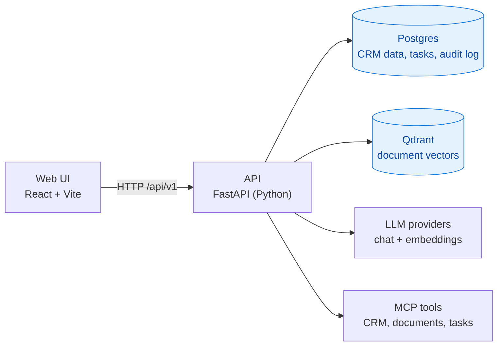

# Customer Compass V3

[](https://github.com/dsailajakrishna0-ship-it/customer-compass-v3/actions/workflows/ci.yml)

A small-business CRM used as an **AI learning project**: chat over CRM facts and documents (RAG), tool calling over MCP, prompt-injection guardrails, evaluation, and a human-in-the-loop agent. All data is synthetic.

V3 starts fresh, seeded from [`customer-compass-v2`](https://github.com/dsailajakrishna0-ship-it/customer-compass-v2) (tag `v2-final`), where every piece was hand-built to learn the mechanics. V3 replaces that hand-written plumbing with open-source frameworks (LangGraph, LiteLLM, Qdrant, Langfuse and others) one stage at a time, measuring each change against a saved baseline. The plan is in [docs/roadmap.md](docs/roadmap.md).

> **Status:** Stage 0 (foundation) in progress. The code is still the V2 seed; the frameworks arrive from Stage 1 on.

## How it fits together



Details: [docs/architecture.md](docs/architecture.md). Technology choices: [docs/tech-stack.md](docs/tech-stack.md).

## Quick start

Requires Docker, Node.js and [uv](https://docs.astral.sh/uv/).

```bash
git clone https://github.com/dsailajakrishna0-ship-it/customer-compass-v3.git
cd customer-compass-v3

cp .env.example .env              # add GOOGLE_API_KEY (free key for embeddings); see comments inside
docker compose up -d db qdrant ollama api-py
docker exec customer-compass-v3-ollama ollama pull qwen2.5:3b   # first run only

npm ci
npm run dev                       # web app at http://localhost:5173
```

Then open the app and click **Ingest documents** once. API docs are at <http://localhost:8001/docs>. Full run and test guide, with every chat mode and sample questions: [docs/testing-guide.md](docs/testing-guide.md). Problems starting up: [docs/troubleshooting.md](docs/troubleshooting.md).

## Developer commands

Install [just](https://just.systems/) once (`uv tool install rust-just`), then:

```bash
just            # list all commands
just lint       # ruff, mypy, ESLint, tsc
just test       # API tests (starts Postgres) and web tests
just fmt        # auto-fix and format Python
just up         # start the stack      just down   # stop it
```

Optional: `uv tool install pre-commit && pre-commit install` to run the checks on every commit. A Dev Container with everything installed is in `.devcontainer/`. Tool choices: [ADR 0002](docs/adr/0002-developer-tooling.md).

## Repository layout

| Path | What is in it |
| --- | --- |
| `apps/web` | React + Vite + TypeScript UI |
| `apps/api-py` | FastAPI service: chat, RAG, CRM queries, guardrails, MCP tools, agent |
| `db` | Postgres schema and seed data |
| `sample-data` | Synthetic CRM documents |
| `evals` | promptfoo evaluation suites |
| `docs` | Plan, architecture, decisions, guides, and the frozen V2 stage records |

## Documentation

Start at [docs/README.md](docs/README.md). Plan: [docs/roadmap.md](docs/roadmap.md). Decisions: [docs/adr/](docs/adr/README.md). The hand-built V2 learning record: [docs/v2-baseline/](docs/v2-baseline/README.md).

## Contributing

One pull request per roadmap sub-stage; `main` is protected. See [CONTRIBUTING.md](CONTRIBUTING.md) and [SECURITY.md](SECURITY.md). Licensed under the [MIT License](LICENSE).
