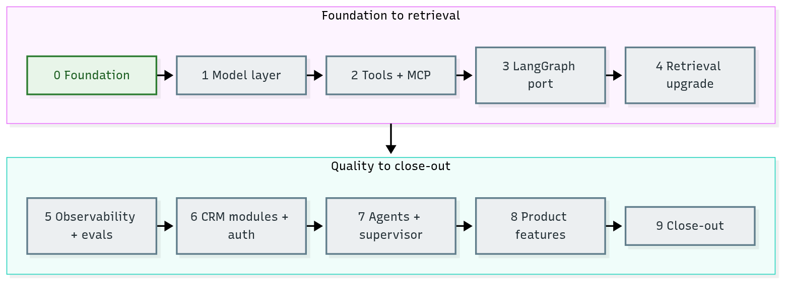

# Customer Compass V3 — Roadmap

customer-compass-v3 starts fresh, seeded from v2's final state (tag
[`v2-final`](https://github.com/dsailajakrishna0-ship-it/customer-compass-v2/releases/tag/v2-final)
of `customer-compass-v2`). V2 stays the closed, hand-built baseline. V3's learning goal is how
open-source frameworks and standard tools replace hand-written plumbing, and what else the product can do.

Sources of this plan: V2's
[`v3-roadmap-draft.md`](https://github.com/dsailajakrishna0-ship-it/customer-compass-v2/blob/v2-final/docs/v3-roadmap-draft.md) (decisions, superseded by this file)
and [`recommendations-2.md`](recommendations-2.md)
(feedback, tooling table, diagrams, risks). Recommendations-2 is the reference for implementation; its tool IDs (T1–T18),
repo findings (R1–R12) and doc findings (D1–D9) are cited below. Decisions are recorded in [`adr/`](adr/README.md).

**AI colour code:** 🟪 concept · 🟦 framework or tool · 🟩 data store or service · 🟧 model. Unmarked technical terms are ordinary software. [A to Z list](ai-terms.md)

## Decisions carried over

- Frameworks replace most hand-written plumbing; V2 remains the baseline.
- Orchestration: 🟦LangGraph. Cloud models only, free tiers only (no paid budget).
- Rule: the frameworks and tooling must be open source; model APIs may be free-tier hosted.
- CRM grows by three modules: support tickets, contracts and renewals, meeting and email notes.
- Every write stays behind human confirmation, the Stage 8 🟪guardrails and the audit log.

## Working rules

- One PR per sub-stage, squash-merged, with CI green before merge.
- All commits and `gh` calls use the `dsailajakrishna0-ship-it` account.
- Each sub-stage has a checkable exit criterion; a stage is done only when all its sub-stages are.
- Each tool choice gets a one-page decision record in `docs/adr/` with the pinned version.
- Stage 0 changes no product behaviour. From Stage 1 on, a change is accepted only if 🟪eval scores stay within the agreed tolerance.
- Merge conflicts that need no decision (stacked PRs after a squash-merge, the ADR index, generated docs) can be resolved with `just resolve-conflicts` ([ADR 0013](adr/0013-conflict-bot.md)); anything else is resolved by a person.
- Verify tool versions, licences and free-tier limits on the project's own page before adopting a tool.
- Every stage ships its **stage guide** in [`stages/`](stages/README.md) (concepts, diagrams, worked examples, glossary, questions) and updates the [tech-stack](tech-stack.md) tables. A stage is done only when its guide is. The [`concepts/`](concepts/README.md) section is assembled in Stage 9 ([ADR 0007](adr/0007-documentation-track.md)).

## Status

| Stage | Name | Status |
| --- | --- | --- |
| 0 | Foundation | Done |
| 1 | Model layer (cloud-only) | Done |
| 2 | Tools and 🟦MCP | Done, except the tool-call 🟪eval check that needs an 🟩OpenRouter key |
| 3 | 🟦LangGraph port | Done (3.1, 3.2a, 3.2b); the live 🟪agent test with keys is the owner's |
| 4 | 🟪Retrieval upgrade | In progress (4.1 and 4.2 done; 4.3 🟪embeddings in review) |
| 5 | Observability and evals | In progress (5.1 tracing merged; 5.2 evals in review) |
| 6 | New CRM modules and auth | Planned |
| 7 | Agents and supervisor | Planned |
| 8 | Product features | Planned |
| 9 | Close-out | Planned |
| Alongside | Sibling repos: [`customer-compass-v3-java`](https://github.com/dsailajakrishna0-ship-it/customer-compass-v3-java) and `claims-compass-v1` | Java repo started; claims and email experiments deferred ([port-status.md](port-status.md)) |

Diagram source: [roadmap-stage-flow.mmd](diagrams/roadmap-stage-flow.mmd)

## Stage 0 — Foundation (startup tasks)

| Sub-stage | Tasks | Exit criteria |
| --- | --- | --- |
| **0.1 Seed the repo** | Tag V2 `main` as `v2-final` (done). Create this repo, public, MIT (done). Copy the V2 files without `.venv`, `node_modules`, `.env` or history. First seed commit says "Seed from customer-compass-v2 @ `<sha>`". Add `.gitignore`, `.editorconfig`, `SECURITY.md`, `CONTRIBUTING.md`. | V3 runs exactly like V2: `docker compose up`, tests green. |
| **0.2 Correct the docs** (D1–D9) | Write a real root README (diagram, quick start, doc links). Fold this roadmap into the docs index. Drop `archive-01/` and the "historical" banners. Remove local absolute paths. Make `tech-stack.md` the single source of stack facts; other docs link to it. Start `docs/adr/` with ADR 0001 (V3 goals and tooling rule). Keep model names out of prose. | No stale status, no absolute paths, no duplicated facts. Links checked by CI (0.4). |
| **0.3 Developer tooling** (R6, T13–T16) | `ruff`, `mypy` or `pyright`, `pre-commit`, pytest with coverage, ESLint, Vitest, a `justfile` (`up`, `test`, `lint`, `eval`, `seed`), Dev Container, pinned image tags (R8). Compose profiles `observability` (5.1) and `eval` arrive with their first services (5.1, 5.2); core stays un-profiled, `.env.example` cleanup. | `just lint && just test` passes locally with one command. |
| **0.4 CI** (R1, T15) | GitHub Actions: lint and types, Python tests with mocked models, web build and tests, docs link check, `docker compose up` smoke test with a health check, secret scan (gitleaks), `pip-audit`, Trivy image scan. Dependabot or Renovate, PR template, issue templates, CODEOWNERS. Then make those checks required on `main`. | A PR with a deliberate failure is blocked; a clean PR merges only after all checks pass. |
| **0.5 CD** (free) | Release workflow on tag `v*`: build the API and web images, push to GHCR, create a GitHub Release with the changelog. | Tagging `v3.0.0-alpha.1` produces images and a release without manual steps. |
| **0.6 Database migrations** (R5, T12) | Alembic baseline from `init.sql` and `002-rag.sql` (schema), demo seed data as its own migration, and a third migration that drops the unused 🟩pgvector column and extension. Plain `postgres:17` image; a `migrate` Compose job runs before the API ([ADR 0005](adr/0005-database-migrations.md)). | A fresh database is built only by migrations, and V2 data tests pass. |
| **0.7 Evaluation baseline** | 🟪Golden set: 30–50 🟪retrieval questions, 10 tool-call cases, 10 🟪agent cases, 20 adversarial cases (extending Stage 8). Add 🟪recall@k and 🟪MRR tests. Run on the seeded code and save the report. | `evals/baseline/v2.json` committed; `just eval` reproduces it within tolerance. |
| **0.8 Documentation track** | Stage guides folder with a template and diagram style; the [Stage 0 guide](stages/00-foundation.md); tech-stack restructured with an "at a glance" table and V3 progress by stage; `concepts/` placeholder; PR template checkbox ([ADR 0007](adr/0007-documentation-track.md)). | Every diagram renders and every number in the Stage 0 guide matches the repo. |

## Stage 1 — Model layer (cloud-only)

| Sub-stage | Tasks | Exit criteria |
| --- | --- | --- |
| **1.1 Config** (R7, T13) | `pydantic-settings`; `models.yaml` for the free-model list; structured logging with request IDs. | No scattered `os.environ` reads. |
| **1.2 🟦LiteLLM gateway** (T1, R9) | Replace `provider.py`, `cloud.py` and the two-provider fallback with an ordered fallback list, retries with backoff and 429 handling. | A forced 429 falls back to the next model, shown in a test. |
| **1.3 Remove 🟩Ollama** (R2) | Full checklist (about 40 files): 🟦promptfoo judge, `compare_guards.py`, `setup-ollama-cache.sh`, `mcp/client.py`, `rag/embeddings.py`, web `types`/`useChat`/`ChatModeSelector`/`MessageBubble`, `GUARD_PROVIDER` default, docs. The provider switch goes too ([ADR 0010](adr/0010-cloud-only-models.md)). | `grep -ri ollama` finds nothing outside ADRs and the places that exist to discuss the removal (the frozen V2 record, this plan, the stack record, the Stage 1 guide, the saved V2 baseline), enforced by `tests/test_no_local_models.py`. |
| **1.4 Test seam and 🟪streaming** (R3, R4) | Typed fake model so tests stop depending on 🟪prompt text. Decide on streaming (SSE). Re-measure the 8-step and 180 s limits on cloud models. | CI uses no network (enforced by a test-suite check); a limits ADR holds the method and the V2 numbers, with the hosted-model numbers still to be measured once a key exists ([ADR 0011](adr/0011-streaming-deferred.md): streaming deferred; [ADR 0012](adr/0012-agent-limits.md)). |

## Stage 2 — Tools and MCP

| Sub-stage | Tasks | Exit criteria |
| --- | --- | --- |
| **2.1 Native 🟪tool calling** (T3) | Native tool calling with Pydantic schemas; remove the fenced-text protocol. | Stage 9 contract tests pass. |
| **2.2a 🟦FastMCP over HTTP** (T10) | One long-lived FastMCP server over streamable HTTP (`mcp-fastmcp` service), replacing the subprocess per chat turn. A configurable choice of tool server (`MCP_BACKEND`, a per-request `mcpServer`, radio buttons in the web app), and `contracts/mcp-tools.json` with a checker both servers must pass ([ADR 0015](adr/0015-mcp-over-http-two-servers.md)). | The contract check passes on the running server in CI; tool-call 🟪eval accuracy is at least the baseline (needs an 🟩OpenRouter key). |
| **2.2b Spring Boot 🟦MCP server** | A Java twin of the four tools in `services/mcp-java` (🟦Spring AI MCP server), as an independent service with its own build and CI job, selectable in the web app. | The same contract check passes on it, in CI. |

## Stage 3 — LangGraph port

| Sub-stage | Tasks | Exit criteria |
| --- | --- | --- |
| **3.1 Test split** (R3) | Split tests into API-contract tests (must pass unchanged) and internal tests (may change). Two named seams (the model and document 🟪retrieval), a boundary check, and the 🟪agent API's failure behaviour in the contract ([ADR 0017](adr/0017-contract-and-internal-tests.md)). | The split is documented (`apps/api-py/tests/README.md`) and enforced by a test. |
| **3.2 Graph** (T2), in two PRs ([ADR 0018](adr/0018-langgraph-graph-and-resume.md)): **3.2a** the graph, same behaviour; **3.2b** pause and resume | Explicit nodes: classify, evidence, documents, analyze, review, draft, 🟪human approval, write. Postgres 🟪checkpointer and `interrupt()` before write. | Contract tests pass unchanged; a paused run survives an API restart. |

## Stage 4 — Retrieval upgrade

| Sub-stage | Tasks | Exit criteria |
| --- | --- | --- |
| **4.1 Hybrid + rerank** (T5), in two PRs ([ADR 0019](adr/0019-hybrid-search-and-reranker.md)): **4.1a** 🟪hybrid search; **4.1b** 🟪reranker | 4.1a: Hybrid search (dense + 🟪BM25 keyword vectors, merged by 🟪reciprocal rank fusion) on 🟩Qdrant. 4.1b: a hosted free-tier cross-encoder reranker, optional and time-limited. | Recall@k and 🟪MRR at least the baseline, measured with `just eval-hybrid`. |
| **4.2 Ingestion** (T6) | 🟦Docling ingestion with source, page or sheet, and 🟪chunk metadata. | Citations show source and page or sheet. |
| **4.3 🟪Embeddings** (T4) | Compare an open-source embedding model (🟦FastEmbed) with 🟧Gemini; re-embed on any change. | ADR records the decision. |

## Stage 5 — Observability and evals

| Sub-stage | Tasks | Exit criteria |
| --- | --- | --- |
| **5.1 Tracing** (T7) | Self-hosted 🟦Langfuse with OpenTelemetry; the audit table stays. | Every 🟪agent run has a trace. |
| **5.2 Evals** (T11) | 🟦Ragas or DeepEval alongside 🟦promptfoo, with a pinned 🟪judge model. | `just eval` prints a metrics table per branch. |
| **5.3 🟪Guardrails** (T8) | Compare our rules with 🟦NeMo Guardrails and 🟧Llama Guard; add 🟦Presidio for 🟪PII. | A results table: detection rate, false positives, latency. |
| **5.4 🟪Agentic 🟪retrieval** | Add to the document search tool, behind a setting and off by default: a relevance check on the retrieved passages, a query rewrite with one retry when they are weak (the Corrective 🟪RAG idea), and a grounding check on the answer. Measured with the 5.2 🟪evals on the same questions as plain 🟪hybrid search. | A before/after table (answer quality, citation correctness, latency, tokens) and a one-page ADR. It ships only if quality improves at acceptable latency and cost; otherwise the ADR records why not. |
| **5.5 Framework comparison** (manual vs frameworks) | After 5.2 and 5.4. One setting per seam, default `manual`: `CHUNKER_IMPL`, `RETRIEVAL_IMPL`, `AGENT_IMPL` (the gateway and the confirm gate stay manual unless a result says otherwise). The `frameworks` side uses 🟦LangChain or 🟦LangGraph prebuilt pieces, behind the same function signature, in an optional dependency group. The contract and eval tests run against both sides in CI, and the framework side must keep the confirm gate, audit log and citations. The Java edition does the same with 🟦Spring AI and LangChain4j. Observability gets one small comparison too: the same agent runs sent to Langfuse (the default) and to LangSmith, judged on setup effort, trace detail and eval features. | One ADR per seam with lines of code, latency, tokens, answer quality and debuggability for both sides. Each ADR ends with a decision and a reason, and "manual wins" is a valid result. Default stays `manual` unless the numbers favour the framework. |

**Framework policy (applies to every stage, decided 2026-11-09).** We build each piece by hand first so the stage guides can show what it does, and we adopt a framework for a piece only when measurements say it helps. Settled today: LangGraph runs the agent (ADR 0018), 🟦LiteLLM runs the model layer (ADR 0009), and retrieval, ingestion and the 🟪reranker call are our own code (ADR 0019, 0020). Open until 5.5: whether LangChain loaders, splitters or retrievers, or a prebuilt agent, replace any of our code; and, in the Java edition, Spring AI versus LangChain4j per piece. The rule for changing a settled or open choice: an ADR with lines of code, latency, tokens and eval quality for both sides, run on the same questions; the default stays `manual` unless the framework side is at least as good on quality and acceptable on latency and cost, and it keeps the confirm gate, audit log and citations. A tool we reject gets a "Why not X?" note (see the anytime docs items) naming the trigger that would make us look again.

## Stage 6 — New CRM modules and auth

| Sub-stage | Tasks | Exit criteria |
| --- | --- | --- |
| **6.1 Auth** (T9, R11) | Authentication and per-tool permissions. | An unauthorised 🟪tool call is rejected, in a test. |
| **6.2 Modules** | Tickets, then contracts and renewals, then meeting notes. Each needs a migration, a seeded generator, tools, known-answer questions and adversarial cases. | Per-module known-answer questions pass; writes stay behind the confirm gate and audit log. |

## Stage 7 — Agents and supervisor

| Sub-stage | Tasks | Exit criteria |
| --- | --- | --- |
| **7.1–7.3** | Add one 🟪agent at a time (triage, renewal-risk, meeting summarizer), then the supervisor with a routing-accuracy metric. An agent is added only if 🟪evals show better quality at acceptable latency and token cost. | Each addition has a one-page ADR with before/after quality, latency and token use. |

## Stage 8 — Product features

| Sub-stage | Tasks | Exit criteria |
| --- | --- | --- |
| **8.1 Add company** (T17) | Add-company form (React Hook Form + Zod) and `POST /api/v1/companies`. | A Playwright happy-path test. |
| **8.2 Upload** | Multi-format upload UI. | A Playwright happy-path test. |

## Stage 9 — Close-out

| Sub-stage | Tasks | Exit criteria |
| --- | --- | --- |
| **9.1 Concepts section** | Assemble [`concepts/`](concepts/README.md) from the stage guides: the **final architecture overview** (system context, containers, main flows; refreshes the V2-era [`architecture.md`](architecture.md)), concept map, A-to-Z glossary, questions and answers by level, "which stage taught what" table, reading paths for a learner, a teammate new to AI and a wider audience. | Every answer links to the guide that proves it; numbers re-checked against the final baseline. |
| **9.2 Close-out** | Final docs pass, V3 retrospective, V2-vs-V3 comparison table (quality, latency, tokens, lines of code), tag `v3.0.0`. | Tag `v3.0.0` produces the release; no stale status anywhere. |

## Anytime — docs-only notes (no code, no stage dependency)

| Item | Tasks | Exit criteria |
| --- | --- | --- |
| **🟪RAG variants guide** | One note, `docs/concepts/rag-variants.md`, with a diagram per variant (Mermaid source in `docs/diagrams/`, rendered like the stage guides). For each: the problem it solves, how it works, a worked example on our CRM data, cost and latency, when not to use it, and whether this repo uses it. Variants: naive RAG (the baseline), 🟪hybrid search and 🟪reranking (built, Stages 4.1), Graph RAG (entities and relations, and the Microsoft-style community-summary variant), 🟪Agentic RAG, Corrective RAG and Self-RAG (5.4), query rewriting and HyDE, multi-query and fusion, parent-document and small-to-big 🟪retrieval, contextual retrieval, multimodal RAG, and RAG vs long context. Ends with a "which one when" decision table and a comparison table. | Every variant has a diagram and a "used here?" line that links to the stage or ADR when it is built; the decision table is checked against the 5.4 results once they exist; terms added to `ai-terms.yaml`. |
| **Graph 🟪RAG prototype (optional)** | Extract entities and relations from the sample documents into two Postgres tables, add one tool that follows them, and compare with plain search on a few cross-document questions. | A one-page ADR with the comparison, even if the answer is "not worth it here". |
| **"Why not X?" decision notes** | A short note per tool or framework we looked at and did not adopt (🟦LangChain chains and retrievers, LangChain model wrappers, a 🟪vector store wrapper, a prebuilt agent, a graph database, a hosted RAG service, LangSmith for tracing and 🟪evals). Each note has the same five lines: what it is, what it would have replaced, why we chose our own code, what we gave up, and when we would reconsider (the trigger, with a link to the 5.5 ADR if one exists). Start from the existing ADRs (0009 🟦LiteLLM, 0018 🟦LangGraph, 0019 hybrid search) and add a "Considered and rejected" table to `docs/tech-stack.md`. | Every adopted or rejected tool in `tech-stack.md` has a one-line reason; each reason names a measurable trigger for revisiting it. |

## Alongside V3 — Sibling repos (decided 2026-11-05)

This repository continues as planned, Stages 0 to 9. The Java edition runs next to it now; the other siblings wait until both are almost complete; [`port-status.md`](port-status.md) is the live table.

| Repo | Domain | Languages | When |
| --- | --- | --- | --- |
| `customer-compass-v3` (this repo) | CRM | Python and Java; the web app's radio buttons pick the path | Now |
| [`customer-compass-v3-java`](https://github.com/dsailajakrishna0-ship-it/customer-compass-v3-java) | CRM, the same API contract | Java only: Spring Boot, 🟦Spring AI | Started; follows this repo by about one stage |
| `claims-compass-v1` | Insurance claims management | Java only; a Python version is decided after seeing it | Deferred until this repo and the Java edition are almost complete |
| `inbox-compass-v1` (name to confirm) | Email: categorize and answer from help articles; an experiment sandbox for model behaviour, built from synthetic or public material only | Python, the same free-tier stack | Deferred, same condition |

**What makes the Java edition possible:** the tool contract (`contracts/mcp-tools.json`), the API-contract tests (`apps/api-py/tests/contract/`, which must pass unchanged on any implementation), the sample data and the 🟪eval 🟪golden set. They are copied to the sibling and recorded in its `docs/shared-assets.md`. A contract change is made here first.

**`claims-compass-v1` in one paragraph:** a claim arrives with forms and photos; policy wording is searched (🟪RAG); coverage is checked with tools; a second 🟪agent reviews fraud signals; a settlement is recommended; a human adjuster approves it. The `v1` is the API version: routes are `/api/v1/claims`, `/api/v1/claims/{id}/documents`, `/api/v1/agent/recommend`, `/api/v1/agent/confirm`; a breaking change would be a new `claims-compass-v2` repo.

**To decide later** (add anything missed):

- Whether the Java edition's agent graph uses Spring AI workflow patterns or LangGraph4j (an ADR in the Java repo, Stage J5).
- The no-framework (plain Java) version and what the comparison measures: lines of code, latency, tokens, quality on the same evals.
- Whether the web app's backend radio points at the Java repo's API, or each edition keeps its own copy of the web app.
- Whether claims also gets a Python version.

**Exit criteria (draft):** each repo starts from a clean `docker compose up`, passes the same contract tests (this repo and the Java edition), and has a short guide that says what it does differently.

## Risks

| Risk | Mitigation |
| --- | --- |
| Free-tier limits or model removal break demos and 🟪evals | Ordered model list, record-and-replay cache for evals, mocked CI, a last-known-good list in `models.yaml` |
| Framework churn (🟦LangChain and 🟦LangGraph APIs move) | Pin versions, record the version in each ADR, keep framework code behind small service modules |
| Scope creep from new modules and 🟪agents | Stage exit criteria; one capability at a time |
| Eval scores drift when the 🟪judge model changes | Pin the judge model and 🟪prompt; store raw judge outputs |
| 🟪Prompt injection through tickets and meeting notes | Adversarial cases per module; keep the untrusted-context wrapper; confirm gate unchanged |
| Secrets in a public repo | gitleaks in CI; `.env` stays ignored; rotate any key that was ever pasted into a doc or log |
