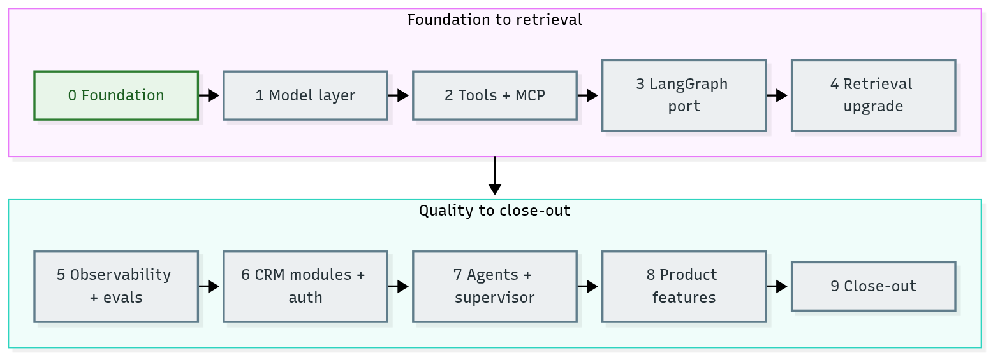

# Customer Compass V3 — Roadmap

customer-compass-v3 starts fresh, seeded from v2's final state (tag
[`v2-final`](https://github.com/dsailajakrishna0-ship-it/customer-compass-v2/releases/tag/v2-final)
of `customer-compass-v2`). V2 stays the closed, hand-built baseline. V3's learning goal is how
open-source frameworks and standard tools replace hand-written plumbing, and what else the product can do.

Sources of this plan: V2's
[`v3-roadmap-draft.md`](https://github.com/dsailajakrishna0-ship-it/customer-compass-v2/blob/v2-final/docs/v3-roadmap-draft.md) (decisions, superseded by this file)
and [`recommendations-2.md`](recommendations-2.md)
(feedback, tooling table, diagrams, risks). Recommendations-2 is the reference for implementation; its tool IDs (T1–T18),
repo findings (R1–R12) and doc findings (D1–D9) are cited below. Decisions are recorded in [`adr/`](adr/README.md).

**AI colour code:** 🟪 concept · 🟦 framework or tool · 🟩 data store or service · 🟧 model. Unmarked technical terms are ordinary software. [A to Z list](ai-terms.md)

## Decisions carried over

- Frameworks replace most hand-written plumbing; V2 remains the baseline.
- Orchestration: 🟦LangGraph. Cloud models only, free tiers only (no paid budget).
- Rule: the frameworks and tooling must be open source; model APIs may be free-tier hosted.
- CRM grows by three modules: support tickets, contracts and renewals, meeting and email notes.
- Every write stays behind human confirmation, the Stage 8 🟪guardrails and the audit log.

## Working rules

- One PR per sub-stage, squash-merged, with CI green before merge.
- All commits and `gh` calls use the `dsailajakrishna0-ship-it` account.
- Each sub-stage has a checkable exit criterion; a stage is done only when all its sub-stages are.
- Each tool choice gets a one-page decision record in `docs/adr/` with the pinned version.
- Stage 0 changes no product behaviour. From Stage 1 on, a change is accepted only if 🟪eval scores stay within the agreed tolerance.
- Verify tool versions, licences and free-tier limits on the project's own page before adopting a tool.
- Every stage ships its **stage guide** in [`stages/`](stages/README.md) (concepts, diagrams, worked examples, glossary, questions) and updates the [tech-stack](tech-stack.md) tables. A stage is done only when its guide is. The [`concepts/`](concepts/README.md) section is assembled in Stage 9 ([ADR 0007](adr/0007-documentation-track.md)).

## Status

| Stage | Name | Status |
| --- | --- | --- |
| 0 | Foundation | Done |
| 1 | Model layer (cloud-only) | In progress (1.1 done; 1.2 and 1.3 in review) |
| 2 | Tools and 🟦MCP | Planned |
| 3 | 🟦LangGraph port | Planned |
| 4 | 🟪Retrieval upgrade | Planned |
| 5 | Observability and 🟪evals | Planned |
| 6 | New CRM modules and auth | Planned |
| 7 | 🟪Agents and supervisor | Planned |
| 8 | Product features | Planned |
| 9 | Close-out | Planned |

Diagram source: [roadmap-stage-flow.mmd](diagrams/roadmap-stage-flow.mmd)

## Stage 0 — Foundation (startup tasks)

| Sub-stage | Tasks | Exit criteria |
| --- | --- | --- |
| **0.1 Seed the repo** | Tag V2 `main` as `v2-final` (done). Create this repo, public, MIT (done). Copy the V2 files without `.venv`, `node_modules`, `.env` or history. First seed commit says "Seed from customer-compass-v2 @ `<sha>`". Add `.gitignore`, `.editorconfig`, `SECURITY.md`, `CONTRIBUTING.md`. | V3 runs exactly like V2: `docker compose up`, tests green. |
| **0.2 Correct the docs** (D1–D9) | Write a real root README (diagram, quick start, doc links). Fold this roadmap into the docs index. Drop `archive-01/` and the "historical" banners. Remove local absolute paths. Make `tech-stack.md` the single source of stack facts; other docs link to it. Start `docs/adr/` with ADR 0001 (V3 goals and tooling rule). Keep model names out of prose. | No stale status, no absolute paths, no duplicated facts. Links checked by CI (0.4). |
| **0.3 Developer tooling** (R6, T13–T16) | `ruff`, `mypy` or `pyright`, `pre-commit`, pytest with coverage, ESLint, Vitest, a `justfile` (`up`, `test`, `lint`, `eval`, `seed`), Dev Container, pinned image tags (R8). Compose profiles `obs` and `eval` arrive with their first services (5.1, 5.2); core stays un-profiled, `.env.example` cleanup. | `just lint && just test` passes locally with one command. |
| **0.4 CI** (R1, T15) | GitHub Actions: lint and types, Python tests with mocked models, web build and tests, docs link check, `docker compose up` smoke test with a health check, secret scan (gitleaks), `pip-audit`, Trivy image scan. Dependabot or Renovate, PR template, issue templates, CODEOWNERS. Then make those checks required on `main`. | A PR with a deliberate failure is blocked; a clean PR merges only after all checks pass. |
| **0.5 CD** (free) | Release workflow on tag `v*`: build the API and web images, push to GHCR, create a GitHub Release with the changelog. | Tagging `v3.0.0-alpha.1` produces images and a release without manual steps. |
| **0.6 Database migrations** (R5, T12) | Alembic baseline from `init.sql` and `002-rag.sql` (schema), demo seed data as its own migration, and a third migration that drops the unused 🟩pgvector column and extension. Plain `postgres:17` image; a `migrate` Compose job runs before the API ([ADR 0005](adr/0005-database-migrations.md)). | A fresh database is built only by migrations, and V2 data tests pass. |
| **0.7 Evaluation baseline** | 🟪Golden set: 30–50 🟪retrieval questions, 10 tool-call cases, 10 🟪agent cases, 20 adversarial cases (extending Stage 8). Add 🟪recall@k and 🟪MRR tests. Run on the seeded code and save the report. | `evals/baseline/v2.json` committed; `just eval` reproduces it within tolerance. |
| **0.8 Documentation track** | Stage guides folder with a template and diagram style; the [Stage 0 guide](stages/00-foundation.md); tech-stack restructured with an "at a glance" table and V3 progress by stage; `concepts/` placeholder; PR template checkbox ([ADR 0007](adr/0007-documentation-track.md)). | Every diagram renders and every number in the Stage 0 guide matches the repo. |

## Stage 1 — Model layer (cloud-only)

| Sub-stage | Tasks | Exit criteria |
| --- | --- | --- |
| **1.1 Config** (R7, T13) | `pydantic-settings`; `models.yaml` for the free-model list; structured logging with request IDs. | No scattered `os.environ` reads. |
| **1.2 🟦LiteLLM gateway** (T1, R9) | Replace `provider.py`, `cloud.py` and the two-provider fallback with an ordered fallback list, retries with backoff and 429 handling. | A forced 429 falls back to the next model, shown in a test. |
| **1.3 Remove 🟩Ollama** (R2) | Full checklist (about 40 files): 🟦promptfoo judge, `compare_guards.py`, `setup-ollama-cache.sh`, `mcp/client.py`, `rag/embeddings.py`, web `types`/`useChat`/`ChatModeSelector`/`MessageBubble`, `GUARD_PROVIDER` default, docs. The provider switch goes too ([ADR 0010](adr/0010-cloud-only-models.md)). | `grep -ri ollama` finds nothing outside ADRs and the places that exist to discuss the removal (the frozen V2 record, this plan, the stack record, the Stage 1 guide, the saved V2 baseline), enforced by `tests/test_no_local_models.py`. |
| **1.4 Test seam and 🟪streaming** (R3, R4) | Typed fake model so tests stop depending on 🟪prompt text. Decide on streaming (SSE). Re-measure the 8-step and 180 s limits on cloud models. | CI uses no network; a limits ADR holds the new numbers. |

## Stage 2 — Tools and MCP

| Sub-stage | Tasks | Exit criteria |
| --- | --- | --- |
| **2.1 Native 🟪tool calling** (T3) | Native tool calling with Pydantic schemas; remove the fenced-text protocol. | Stage 9 contract tests pass. |
| **2.2 🟦FastMCP over HTTP** (T10) | One long-lived FastMCP server over streamable HTTP, replacing the subprocess per chat turn. | Tool-call 🟪eval accuracy is at least the baseline. |

## Stage 3 — LangGraph port

| Sub-stage | Tasks | Exit criteria |
| --- | --- | --- |
| **3.1 Test split** (R3) | Split tests into API-contract tests (must pass unchanged) and internal tests (may change). | The split is documented. |
| **3.2 Graph** (T2) | Explicit nodes: classify, evidence, documents, analyze, review, draft, 🟪human approval, write. Postgres 🟪checkpointer and `interrupt()` before write. | Contract tests pass unchanged; a paused run survives an API restart. |

## Stage 4 — Retrieval upgrade

| Sub-stage | Tasks | Exit criteria |
| --- | --- | --- |
| **4.1 Hybrid + rerank** (T5) | 🟪Hybrid search (dense + 🟪BM25) and a 🟪cross-encoder reranker on 🟩Qdrant. | Recall@k and 🟪MRR at least the baseline. |
| **4.2 Ingestion** (T6) | 🟦Docling ingestion with source, page or sheet, and 🟪chunk metadata. | Citations show source and page or sheet. |
| **4.3 🟪Embeddings** (T4) | Compare an open-source embedding model (🟦FastEmbed) with 🟧Gemini; re-embed on any change. | ADR records the decision. |

## Stage 5 — Observability and evals

| Sub-stage | Tasks | Exit criteria |
| --- | --- | --- |
| **5.1 Tracing** (T7) | Self-hosted 🟦Langfuse with OpenTelemetry; the audit table stays. | Every 🟪agent run has a trace. |
| **5.2 Evals** (T11) | 🟦Ragas or DeepEval alongside 🟦promptfoo, with a pinned 🟪judge model. | `just eval` prints a metrics table per branch. |
| **5.3 🟪Guardrails** (T8) | Compare our rules with 🟦NeMo Guardrails and 🟧Llama Guard; add 🟦Presidio for 🟪PII. | A results table: detection rate, false positives, latency. |

## Stage 6 — New CRM modules and auth

| Sub-stage | Tasks | Exit criteria |
| --- | --- | --- |
| **6.1 Auth** (T9, R11) | Authentication and per-tool permissions. | An unauthorised 🟪tool call is rejected, in a test. |
| **6.2 Modules** | Tickets, then contracts and renewals, then meeting notes. Each needs a migration, a seeded generator, tools, known-answer questions and adversarial cases. | Per-module known-answer questions pass; writes stay behind the confirm gate and audit log. |

## Stage 7 — Agents and supervisor

| Sub-stage | Tasks | Exit criteria |
| --- | --- | --- |
| **7.1–7.3** | Add one 🟪agent at a time (triage, renewal-risk, meeting summarizer), then the supervisor with a routing-accuracy metric. An agent is added only if 🟪evals show better quality at acceptable latency and token cost. | Each addition has a one-page ADR with before/after quality, latency and token use. |

## Stage 8 — Product features

| Sub-stage | Tasks | Exit criteria |
| --- | --- | --- |
| **8.1 Add company** (T17) | Add-company form (React Hook Form + Zod) and `POST /api/v1/companies`. | A Playwright happy-path test. |
| **8.2 Upload** | Multi-format upload UI. | A Playwright happy-path test. |

## Stage 9 — Close-out

| Sub-stage | Tasks | Exit criteria |
| --- | --- | --- |
| **9.1 Concepts section** | Assemble [`concepts/`](concepts/README.md) from the stage guides: the **final architecture overview** (system context, containers, main flows; refreshes the V2-era [`architecture.md`](architecture.md)), concept map, A-to-Z glossary, questions and answers by level, "which stage taught what" table, reading paths for a learner, a teammate new to AI and a wider audience. | Every answer links to the guide that proves it; numbers re-checked against the final baseline. |
| **9.2 Close-out** | Final docs pass, V3 retrospective, V2-vs-V3 comparison table (quality, latency, tokens, lines of code), tag `v3.0.0`. | Tag `v3.0.0` produces the release; no stale status anywhere. |

## Risks

| Risk | Mitigation |
| --- | --- |
| Free-tier limits or model removal break demos and 🟪evals | Ordered model list, record-and-replay cache for evals, mocked CI, a last-known-good list in `models.yaml` |
| Framework churn (🟦LangChain and 🟦LangGraph APIs move) | Pin versions, record the version in each ADR, keep framework code behind small service modules |
| Scope creep from new modules and 🟪agents | Stage exit criteria; one capability at a time |
| Eval scores drift when the 🟪judge model changes | Pin the judge model and 🟪prompt; store raw judge outputs |
| 🟪Prompt injection through tickets and meeting notes | Adversarial cases per module; keep the untrusted-context wrapper; confirm gate unchanged |
| Secrets in a public repo | gitleaks in CI; `.env` stays ignored; rotate any key that was ever pasted into a doc or log |
