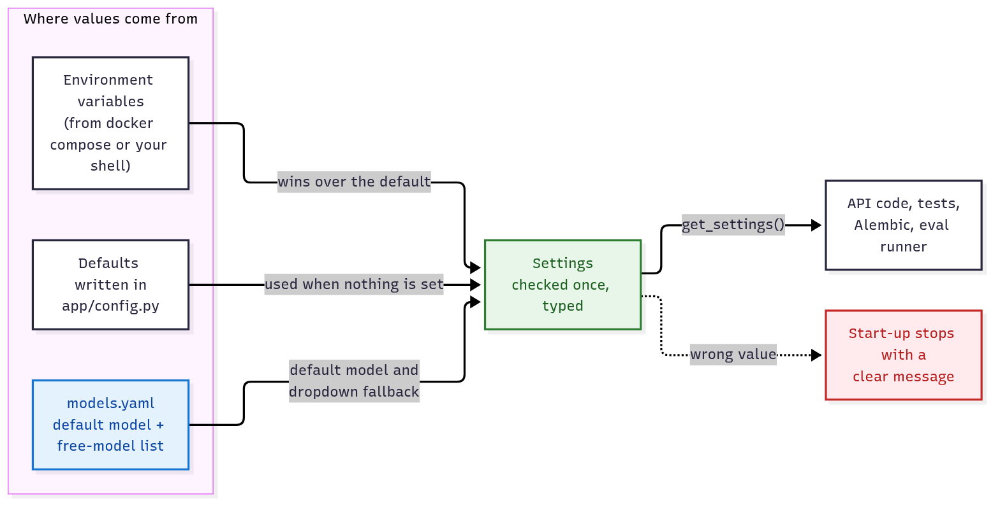
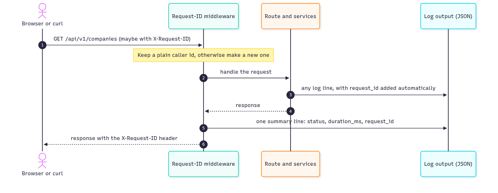
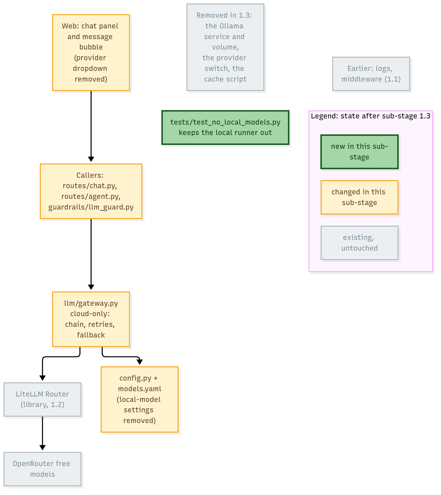

# Stage 1 — Model layer: settings, logging, and calling models safely

> **Level:** beginner friendly. **Reading time:** about 20 minutes for what is written so far.
> **Status:** in progress. **1.1 is written; 1.2 to 1.4 are added as they are built.**
> **Roadmap:** [Stage 1](../roadmap.md#stage-1--model-layer-cloud-only) · **Decisions:** [ADR 0008](../adr/0008-config-and-logging.md) (more to come)

**AI colour code:** 🟪 concept · 🟦 framework or tool · 🟩 data store or service · 🟧 model. Unmarked technical terms are ordinary software. [A to Z list](../ai-terms.md)

## In one minute

Stage 1 prepares the part of the app that talks to AI models. Before swapping in a better way to call them, we first make the app **easy to configure, safe with secrets, and easy to follow when something goes wrong**. Think of the control room of a factory:

| Control-room idea | Project idea | What we built in 1.1 |
| --- | --- | --- |
| One labelled panel instead of switches hidden around the building | **Typed settings** | `app/config.py` is the only place that reads configuration |
| A list of approved suppliers, with a spare list if the usual one is closed | **Model catalogue** | `models.yaml`, with a fallback for the dropdown |
| A numbered ticket attached to every order, so you can follow it through every station | **Request IDs and structured logs** | Every log line of a request carries the same id |

Still to come in this stage: a gateway that calls many model providers through one interface with automatic fallback (1.2), removing the local 🟩Ollama model (1.3), and a fake model for tests plus 🟪streaming (1.4). Their sections are added when they are built.

## The big picture (1.1)



<sub>Diagram source: [stage1-settings-sources.mmd](../diagrams/stage1-settings-sources.mmd)</sub>

---

## Concept 1 — Settings: one place, typed, checked early

**The problem.** In V2, the app read its configuration in **22 places across 12 files**, each with its own default. Nobody could answer "what can I configure?" without searching the code, and a typo could go unnoticed: setting `LLM_PROVIDER=openrouter` (a plausible guess) was quietly replaced by the default `ollama`, so the app ran, just not the way you asked.

**The idea.** Describe all settings once, as a typed class. At start-up the app reads the environment, converts each value to the right type (a number is a number, not text), and **checks it**. Everything else asks the settings object.

```python
class Settings(BaseSettings):
    llm_provider: Literal["ollama", "cloud"] = "ollama"
    agent_max_steps: int = 8
    google_api_key: SecretStr = SecretStr("")
```

Three rules make it safe:

1. **Fail fast.** A wrong value stops start-up with a message that names the setting. This is the real message for `LLM_PROVIDER=openrouter`:

   ```text
   1 validation error for Settings
   llm_provider
     Input should be 'ollama' or 'cloud' [type=literal_error, input_value='openrouter', input_type=str]
   ```

   A loud failure at start-up beats a quiet surprise at 2 a.m.
2. **Secrets are wrapped.** A `SecretStr` prints as `**********`, so an API key cannot slip into a log line or an error message by accident. You must ask for it explicitly, with `.get_secret_value()`.
3. **Empty means "not set".** Docker Compose passes `GUARD_MODEL: ${GUARD_MODEL:-}` to the container as an **empty string** when you did not set it. Without care, an empty string would count as a value. The settings class treats an empty variable as unset, so the default applies.

**Where a value comes from**, highest priority first: an environment variable, then the default written in code. The model names also come from `models.yaml` (next concept).

> [!NOTE]
> This idea is called **twelve-factor configuration**: keep settings in the environment, not in the code, so the same program runs unchanged on your laptop, in CI and in production.

### Testing settings

Because settings are read once and cached, a test that changes an environment variable must make the app read again. An automatic test fixture clears the cache before and after every test. Another test enforces the design: it fails if any file other than `config.py` touches `os.environ`.

---

## Concept 2 — The model catalogue (`models.yaml`)

**The problem.** The free AI models we use change all the time: they appear, disappear, and hit rate limits. In V2 the only list of them was 🟩OpenRouter's live catalogue. If OpenRouter could not be reached, the web app's model dropdown simply failed with an error.

**The idea.** Keep a small, reviewed file in the repo, [`apps/api-py/models.yaml`](../../apps/api-py/models.yaml):

```yaml
openrouter:
  default: liquid/lfm-2.5-2.6b:free
  last_known_good:
    - id: google/gemma-4-31b-it:free
      name: "Google: Gemma 4 31B (free)"
    # ...
```

- `default` is the model used when a request does not name one (an `OPENROUTER_MODEL` variable still wins).
- `last_known_good` is what the dropdown shows when the live list cannot be fetched. The response now says where it came from: `"source": "live"` or `"source": "fallback"`.

The file is **validated when loaded**: the default must be in the list, and a test checks that only `:free` models appear (our rule: free tier only).

> [!WARNING]
> Every id in the file was checked against OpenRouter's catalogue on 2026-10-30, but they are **not ranked by quality**. Free models vanish without notice, so the file ages. Stage 1.2 uses it to build an ordered fallback chain, ranked using the evaluation baseline.

---

## Concept 3 — Structured logs and request IDs

**The problem.** A normal log is a sentence for a human to read. With several requests at once, lines from different requests interleave, and you cannot tell which belong together:

```text
INFO:     172.30.0.1:36418 - "GET /api/v1/companies HTTP/1.1" 200 OK
```

**The idea, part 1: structured logs.** Write each log line as a small JSON object with named fields, so a machine can filter and count them, and a person can still read them. This is a real line from the running API:

```json
{"status": 200, "duration_ms": 1, "event": "request", "method": "GET",
 "path": "/api/v1/companies", "request_id": "my-trace-42",
 "logger": "app.request", "level": "info", "timestamp": "2026-10-29T19:06:19.557Z"}
```

**The idea, part 2: a request ID.** Give every request a unique ticket number when it arrives, and attach it to **every** log line made while handling it. Then one search finds the whole story of one request:

```bash
docker logs customer-compass-v3-api-py 2>&1 | grep 263f8afa035842f0b94d7df48ac7a214
```



<sub>Diagram source: [stage1-request-id-flow.mmd](../diagrams/stage1-request-id-flow.mmd)</sub>

Details worth knowing:

- **You can bring your own id.** Send `X-Request-ID: my-trace-42` and the server uses it, so a front end or another service can pass the same id along.
- **Callers cannot inject text.** Only plain tokens (letters, digits, `.`, `_`, `-`, up to 64 characters) are accepted. A header such as `X-Request-ID: x"} {"level":"error"...` is replaced by a generated id, so nobody can forge log lines.
- **Existing code needed no rewrite.** The older `logger.info("...")` calls are routed through the same pipeline, so they gain the id and the JSON format automatically.
- **One line per request.** The server's own access line is switched off; the middleware logs a single summary (status, duration) that carries the id. The health check, which Docker calls every few seconds, is logged only at debug level so it does not flood the logs.
- **Later this id becomes the trace id** when 🟦Langfuse tracing arrives in Stage 5.

### A surprise we met: the logs could have leaked an API key

While testing, a log line appeared that we did not write: the HTTP library (`httpx`) logs **every outgoing request URL** at INFO level. Our 🟪embeddings call sends the Google API key **in the URL** (`...embedContent?key=YOUR_KEY`). V2 never showed this only because its root logger stayed at the quieter WARNING level. Turning on proper logging would have printed the key into every log line.

The fix is two lines (keep `httpx` and `httpcore` at WARNING) and a regression test that sends a request with a fake key and asserts the key never reaches the output. We also confirmed the test **fails without the fix**, which is the proof that a test actually guards something.

> [!IMPORTANT]
> Lesson: when you change what gets logged, look at what the libraries you use log too. Secrets in URLs are the classic leak. A check that has never been seen to fail is not yet a check.

---

## Code tour: what was added in 1.1, and why

Bright green is new in this sub-stage, amber is an existing module that changed, grey is existing and untouched. In later sub-stages the green boxes turn grey and the newly added modules turn bright, so you can see how the code grows. Markers in the tables: 🟢 new, 🟡 changed, ⚪ earlier.



<sub>Diagram source: [stage1-module-map.mmd](../diagrams/stage1-module-map.mmd)</sub>

### New files

| | Added in | File | What it is for | Names to look at | Used by |
| --- | --- | --- | --- | --- | --- |
| 🟢 | 1.1 | [`app/config.py`](../../apps/api-py/app/config.py) | The single source of every setting and the model catalogue | `Settings` (24 typed fields), `get_settings()`, `get_model_catalog()`, `reset_settings()`, `subprocess_env()` | Every service module, the migrations, the 🟪eval runner |
| 🟢 | 1.1 | [`models.yaml`](../../apps/api-py/models.yaml) | The default model and the last-known-good free-model list | `openrouter.default`, `openrouter.last_known_good` | `config.py`, which validates it; the `/llm/models` route |
| 🟢 | 1.1 | [`app/logs.py`](../../apps/api-py/app/logs.py) | Sets up JSON logging for both new and existing log calls | `configure_logging()` | `main.py` at start-up |
| 🟢 | 1.1 | [`app/middleware.py`](../../apps/api-py/app/middleware.py) | Gives each request an id, returns it in a header, logs one summary line | `RequestIdMiddleware`, `REQUEST_ID_HEADER` | `main.py` (added as the outermost layer) |
| 🟢 | 1.1 | [`tests/test_config.py`](../../apps/api-py/tests/test_config.py) | 10 tests: defaults unchanged, overrides, bad values, secrets, catalogue rules, "only config.py reads the environment" | | CI |
| 🟢 | 1.1 | [`tests/test_logging.py`](../../apps/api-py/tests/test_logging.py) | 8 tests: request ids, unsafe ids, JSON lines, crash logging, no key leak | | CI |
| 🟢 | 1.1 | [`tests/test_llm_models_route.py`](../../apps/api-py/tests/test_llm_models_route.py) | 2 tests: the live model list and the fallback | | CI |

### Existing files that changed, and what changed

| | Changed in | File | Change |
| --- | --- | --- | --- |
| 🟡 | 1.1 | `app/main.py` | Calls `configure_logging()`, adds the middleware, exposes the `X-Request-ID` header to browsers |
| 🟡 | 1.1 | `app/routes/llm.py` | Falls back to `models.yaml` instead of returning 503; adds `"source"` to the response |
| 🟡 | 1.1 | `app/db.py`, `app/rag/embeddings.py`, `app/rag/qdrant_store.py`, `app/rag/retrieve.py`, `app/rag/ingest.py` | Read the database URL, 🟩Qdrant settings, the 🟪embedding model and API key from settings. `qdrant_store.collection_name()` replaces the old `COLLECTION_NAME` constant |
| 🟡 | 1.1 | `app/llm/ollama.py`, `app/llm/cloud.py`, `app/llm/provider.py`, `app/routes/chat.py` | Model URLs, names and keys from settings. `provider.default_llm_provider()` replaces the old constant |
| 🟡 | 1.1 | `app/guardrails/llm_guard.py`, `app/guardrails/audit.py`, `app/agent/policies.py` | Guard mode, retention days and the 🟪agent limits from settings |
| 🟡 | 1.1 | `app/mcp/client.py` | Passes the environment to the tool-server process through `subprocess_env()` |
| 🟡 | 1.1 | `migrations/env.py`, `evals/run_eval.py` | Use the same settings as the API |
| 🟡 | 1.1 | `Dockerfile`, `docker-compose.yml`, `.env.example` | Copy `models.yaml` into the image, turn off uvicorn's access log, new `LOG_LEVEL` and `LOG_FORMAT` |

### A good reading order

1. **`config.py`**: start at the `Settings` class, then `get_settings()`. Everything else depends on it.
2. **`test_config.py`**: read the test names; together they describe the rules in plain sentences.
3. **`middleware.py`**: about 60 lines. Follow `__call__` from top to bottom: read the id, bind it, call the app, log.
4. **`logs.py`**: how standard `logging` and `structlog` are joined into one pipeline.
5. **`routes/llm.py`**: the small, visible effect of the model catalogue.

### What happens, in order, when a request arrives

1. The server starts `main.py`, which sets up logging (`logs.py`) and registers the middleware.
2. A request reaches `RequestIdMiddleware`, which picks or generates an id and stores it for the duration of the request.
3. The matching route runs. Anything it logs, or any service it calls logs, automatically carries the id.
4. Services ask `get_settings()` for values (database URL, model names, limits). The first call builds and validates the settings; later calls reuse them.
5. The response goes back through the middleware, which adds the `X-Request-ID` header and logs one summary line.

## What this stage added to the tech stack (so far)

| Tool | What it does in plain words | Where to look |
| --- | --- | --- |
| **pydantic-settings** | Reads environment variables into a typed, validated settings object | `apps/api-py/app/config.py` |
| **structlog** | Writes structured (JSON) log lines and attaches context such as the request id | `apps/api-py/app/logs.py`, `middleware.py` |
| **PyYAML** | Reads `models.yaml` | `apps/api-py/models.yaml` |

The full list and the stage each tool joins are in [tech-stack.md](../tech-stack.md#v3-tech-stack-at-a-glance).

## V2 vs V3 in this area

| | V2 (seed) | V3 after 1.1 | Why it changed |
| --- | --- | --- | --- |
| Reading configuration | 22 `os.environ` reads in 12 files, each with its own default | One `Settings` class; a test forbids other files from reading the environment | One list of what is configurable, checked once |
| A wrong value | Sometimes silently replaced by a default | Start-up stops with a message naming the setting | No silent misconfiguration |
| Secrets | Plain strings | Wrapped, printed as `**********` | Cannot leak into logs by accident |
| Model list | Only 🟩OpenRouter's live list; dropdown fails if unreachable | Live list, with `models.yaml` as fallback | Free models rotate; the UI should still work |
| Logs | Plain text, no way to follow one request | JSON with a request id on every line | Searchable and traceable |

## Glossary (1.1)

- **Environment variable**: a named value the operating system hands to a program (`LLM_PROVIDER=cloud`).
- **Fail fast**: stop immediately and loudly on a bad setting instead of continuing in a broken state.
- **Fallback**: a prepared second choice used when the first one fails.
- **JSON**: a simple text format for structured data: `{"name": "value"}`.
- **Log injection**: tricking a program into writing forged lines into its logs by sending text with line breaks or quotes.
- **Middleware**: code that wraps every request, before and after the real handler.
- **Request ID**: a unique number attached to one request and to every log line it causes.
- **Secret**: a value that must not be shown or logged, such as an API key.
- **Settings (configuration)**: the values that change how the program behaves without changing its code.
- **Structured logging**: logs written as named fields, not free-form sentences.
- **Twelve-factor app**: a set of habits for portable services; the first one here is "configuration lives in the environment".

## Check your understanding

<details><summary>1. Why is it better for a wrong <code>LLM_PROVIDER</code> to stop start-up than to fall back to a default?</summary>

A silent fallback hides the mistake: the app runs, just not as you asked, and you may only notice later from odd behaviour. A start-up error names the setting immediately, when it is cheapest to fix.
</details>

<details><summary>2. What does <code>SecretStr</code> protect against, and what does it not?</summary>

It stops the value being printed by accident (in logs, error messages, `repr`). It does not encrypt anything and does not stop code that deliberately calls `.get_secret_value()` and then logs the result. It is a seatbelt, not a vault.
</details>

<details><summary>3. Docker Compose passes an unset variable as an empty string. Why does that matter for settings?</summary>

Without special handling an empty string would be a real value (for example an empty model name) and override the default. The settings class treats an empty variable as unset, so the default applies.
</details>

<details><summary>4. A user sends the header <code>X-Request-ID: a b "c"</code>. What happens, and why?</summary>

The server ignores it and generates its own id, because it contains spaces and quotes. Only short plain tokens are accepted, so a caller cannot put arbitrary text into the logs.
</details>

<details><summary>5. How would you find everything that happened during one slow request?</summary>

Take its request id (from the response header or the summary line) and search the logs for it. Every line made while handling that request carries the same id.
</details>

<details><summary>6. Why did turning on INFO-level logging risk leaking the Google API key?</summary>

The 🟪embeddings call sends the key as a URL parameter, and the HTTP library logs each request URL at INFO level. The fix keeps that library's logger at WARNING, and a test proves the key stays out.
</details>

<details><summary>7. The model dropdown now shows a saved list when 🟩OpenRouter is down. What is the trade-off?</summary>

The UI keeps working, but the saved list can be out of date: a model in it may no longer exist. That is why the response says <code>"source": "fallback"</code>, and why the list is re-checked from time to time.
</details>

## Further reading

- pydantic-settings: <https://docs.pydantic.dev/latest/concepts/pydantic_settings/>
- structlog: <https://www.structlog.org/>
- The twelve-factor app, configuration: <https://12factor.net/config>
