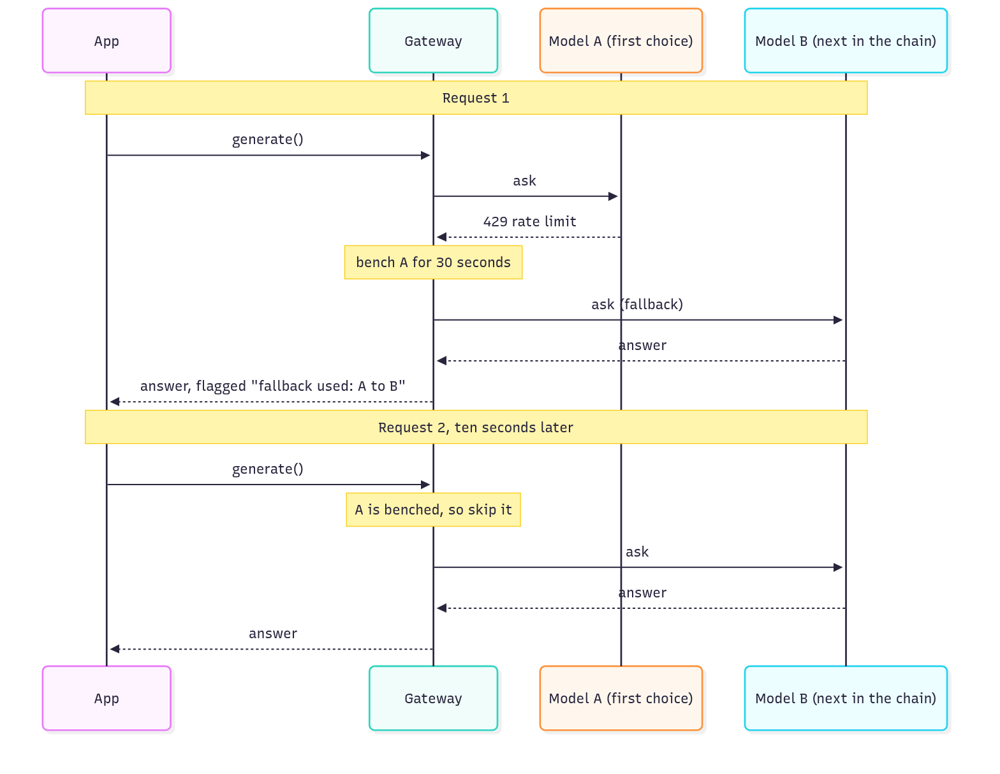

# Stage 1 — Model layer: settings, logging, and calling models safely

> **Level:** beginner friendly. **Reading time:** about 35 minutes for what is written so far.
> **Status:** in progress. **1.1 and 1.2 are written; 1.3 and 1.4 are added as they are built.**
> **Roadmap:** [Stage 1](../roadmap.md#stage-1--model-layer-cloud-only) · **Decisions:** [ADR 0008](../adr/0008-config-and-logging.md), [ADR 0009](../adr/0009-litellm-gateway.md) (more to come)

**AI colour code:** 🟪 concept · 🟦 framework or tool · 🟩 data store or service · 🟧 model. Unmarked technical terms are ordinary software. [A to Z list](../ai-terms.md)

## In one minute

Stage 1 prepares the part of the app that talks to AI models. Before swapping in a better way to call them, we first make the app **easy to configure, safe with secrets, and easy to follow when something goes wrong**. Think of the control room of a factory:

| Control-room idea | Project idea | What we built |
| --- | --- | --- |
| One labelled panel instead of switches hidden around the building | **Typed settings** | `app/config.py` is the only place that reads configuration |
| A list of approved suppliers, with a spare list if the usual one is closed | **Model catalogue** | `models.yaml`, with a fallback for the dropdown |
| A numbered ticket attached to every order, so you can follow it through every station | **Request IDs and structured logs** | Every log line of a request carries the same id |
| A switchboard that tries the next line when one is busy, waits a moment if a line only glitches, and stops ringing a line that just failed | **🟪Model gateway** (1.2) | `gateway.py`: an ordered fallback chain, retries with growing waits, a cool-down, one result shape |

Still to come in this stage: removing the local 🟩Ollama model (1.3), and a fake model for tests plus 🟪streaming (1.4). Their sections are added when they are built.

## The big picture (1.1)


<sub>Diagram source: [stage1-settings-sources.mmd](../diagrams/stage1-settings-sources.mmd)</sub>

---

## Concept 1 — Settings: one place, typed, checked early

**The problem.** In V2, the app read its configuration in **22 places across 12 files**, each with its own default. Nobody could answer "what can I configure?" without searching the code, and a typo could go unnoticed: setting `LLM_PROVIDER=openrouter` (a plausible guess) was quietly replaced by the default `ollama`, so the app ran, just not the way you asked.

**The idea.** Describe all settings once, as a typed class. At start-up the app reads the environment, converts each value to the right type (a number is a number, not text), and **checks it**. Everything else asks the settings object.

```python
class Settings(BaseSettings):
    llm_provider: Literal["ollama", "cloud"] = "ollama"
    agent_max_steps: int = 8
    google_api_key: SecretStr = SecretStr("")
```

Three rules make it safe:

1. **Fail fast.** A wrong value stops start-up with a message that names the setting. This is the real message for `LLM_PROVIDER=openrouter`:

   ```text
   1 validation error for Settings
   llm_provider
     Input should be 'ollama' or 'cloud' [type=literal_error, input_value='openrouter', input_type=str]
   ```

   A loud failure at start-up beats a quiet surprise at 2 a.m.
2. **Secrets are wrapped.** A `SecretStr` prints as `**********`, so an API key cannot slip into a log line or an error message by accident. You must ask for it explicitly, with `.get_secret_value()`.
3. **Empty means "not set".** Docker Compose passes `GUARD_MODEL: ${GUARD_MODEL:-}` to the container as an **empty string** when you did not set it. Without care, an empty string would count as a value. The settings class treats an empty variable as unset, so the default applies.

**Where a value comes from**, highest priority first: an environment variable, then the default written in code. The model names also come from `models.yaml` (next concept).

> [!NOTE]
> This idea is called **twelve-factor configuration**: keep settings in the environment, not in the code, so the same program runs unchanged on your laptop, in CI and in production.

### Testing settings

Because settings are read once and cached, a test that changes an environment variable must make the app read again. An automatic test fixture clears the cache before and after every test. Another test enforces the design: it fails if any file other than `config.py` touches `os.environ`.

---

## Concept 2 — The model catalogue (`models.yaml`)

**The problem.** The free AI models we use change all the time: they appear, disappear, and hit rate limits. In V2 the only list of them was 🟩OpenRouter's live catalogue. If OpenRouter could not be reached, the web app's model dropdown simply failed with an error.

**The idea.** Keep a small, reviewed file in the repo, [`apps/api-py/models.yaml`](../../apps/api-py/models.yaml):

```yaml
openrouter:
  default: liquid/lfm-2.5-2.6b:free
  last_known_good:
    - id: google/gemma-4-31b-it:free
      name: "Google: Gemma 4 31B (free)"
    # ...
```

- `default` is the model used when a request does not name one (an `OPENROUTER_MODEL` variable still wins).
- `last_known_good` is what the dropdown shows when the live list cannot be fetched. The response now says where it came from: `"source": "live"` or `"source": "fallback"`.

The file is **validated when loaded**: the default must be in the list, and a test checks that only `:free` models appear (our rule: free tier only).

> [!WARNING]
> Every id in the file was checked against OpenRouter's catalogue on 2026-10-30, but they are **not ranked by quality**. Free models vanish without notice, so the file ages. Stage 1.2 uses it to build an ordered fallback chain, ranked using the evaluation baseline.

---

## Concept 3 — Structured logs and request IDs

**The problem.** A normal log is a sentence for a human to read. With several requests at once, lines from different requests interleave, and you cannot tell which belong together:

```text
INFO:     172.30.0.1:36418 - "GET /api/v1/companies HTTP/1.1" 200 OK
```

**The idea, part 1: structured logs.** Write each log line as a small JSON object with named fields, so a machine can filter and count them, and a person can still read them. This is a real line from the running API:

```json
{"status": 200, "duration_ms": 1, "event": "request", "method": "GET",
 "path": "/api/v1/companies", "request_id": "my-trace-42",
 "logger": "app.request", "level": "info", "timestamp": "2026-10-29T19:06:19.557Z"}
```

**The idea, part 2: a request ID.** Give every request a unique ticket number when it arrives, and attach it to **every** log line made while handling it. Then one search finds the whole story of one request:

```bash
docker logs customer-compass-v3-api-py 2>&1 | grep 263f8afa035842f0b94d7df48ac7a214
```


<sub>Diagram source: [stage1-request-id-flow.mmd](../diagrams/stage1-request-id-flow.mmd)</sub>

Details worth knowing:

- **You can bring your own id.** Send `X-Request-ID: my-trace-42` and the server uses it, so a front end or another service can pass the same id along.
- **Callers cannot inject text.** Only plain tokens (letters, digits, `.`, `_`, `-`, up to 64 characters) are accepted. A header such as `X-Request-ID: x"} {"level":"error"...` is replaced by a generated id, so nobody can forge log lines.
- **Existing code needed no rewrite.** The older `logger.info("...")` calls are routed through the same pipeline, so they gain the id and the JSON format automatically.
- **One line per request.** The server's own access line is switched off; the middleware logs a single summary (status, duration) that carries the id. The health check, which Docker calls every few seconds, is logged only at debug level so it does not flood the logs.
- **Later this id becomes the trace id** when 🟦Langfuse tracing arrives in Stage 5.

### A surprise we met: the logs could have leaked an API key

While testing, a log line appeared that we did not write: the HTTP library (`httpx`) logs **every outgoing request URL** at INFO level. Our 🟪embeddings call sends the Google API key **in the URL** (`...embedContent?key=YOUR_KEY`). V2 never showed this only because its root logger stayed at the quieter WARNING level. Turning on proper logging would have printed the key into every log line.

The fix is two lines (keep `httpx` and `httpcore` at WARNING) and a regression test that sends a request with a fake key and asserts the key never reaches the output. We also confirmed the test **fails without the fix**, which is the proof that a test actually guards something.

> [!IMPORTANT]
> Lesson: when you change what gets logged, look at what the libraries you use log too. Secrets in URLs are the classic leak. A check that has never been seen to fail is not yet a check.

---

## Concept 4 — Calling models safely: the model gateway

**The problem.** A free model is not a dependable service. It can say "too many requests" (HTTP **429**), time out, or fail for a moment and work again seconds later. V2 handled all of that with one blunt rule: if the cloud provider failed, switch to the small local model. So a single 429 on one free model threw away the whole cloud provider, nothing waited or retried, and the next request hit the same overloaded model again. Every provider's quirks (token counts, error shapes, costs) were also parsed by our own code.

**The idea.** Put one door in front of every model call, a **🟪model gateway**, and give it the rules. Behind the door, the open-source library 🟦LiteLLM talks to many providers in one common way. We only decide the policy:

1. **An ordered chain.** Try the model that was asked for, then the models listed under `fallback_chain` in `models.yaml`, then the other provider (kept from V2 until 🟩Ollama goes in 1.3).
2. **Tell failures apart, because each deserves a different answer:**

   | What happened | What it usually means | What the gateway does |
   | --- | --- | --- |
   | **429**, rate limit | "Come back later." Asking again now will only fail again. | **No retry.** Bench the model and go to the next one at once. |
   | **Timeout or server error** | Often clears in seconds. | **Retry the same model**, up to 2 times, waiting a little longer each time (**backoff**), then move on. |
   | **Anything else** (bad request, wrong key) | Retrying will not help. | No retry; move on. |

3. **A cool-down.** A model that just failed is skipped for 30 seconds, so the next requests do not hammer it. A 429 benches it immediately; a timeout or server error only after its retries have run out.
4. **One result shape.** Callers get the same `GenerationResult` whichever model answered, including whether a fallback was used and which model failed first. The web app shows a note such as: *"liquid/lfm-2.5-2.6b:free was unavailable (rate limit or error): answered by google/gemma-4-31b-it:free instead."*
5. **One safe error.** If every model fails, the user gets one clear message naming the models tried and the kind of the last error. It never contains keys or the provider's raw message.


<sub>Diagram source: [stage1-failure-handling.mmd](../diagrams/stage1-failure-handling.mmd)</sub>



<sub>Diagram source: [stage1-fallback-example.mmd](../diagrams/stage1-fallback-example.mmd)</sub>

The policy is a few lines of configuration (abridged from `app/llm/gateway.py`):

```python
retry_policy=RetryPolicy(
    RateLimitErrorRetries=0,       # 429: do not retry this model, go to the next
    TimeoutErrorRetries=retries,   # timeouts: retry with growing waits
    InternalServerErrorRetries=retries,
),
allowed_fails_policy=AllowedFailsPolicy(
    RateLimitErrorAllowedFails=0,  # a 429 benches the model at once
    TimeoutErrorAllowedFails=retries,
),
cooldown_time=cooldown,
```

| Setting | Default | Meaning |
| --- | --- | --- |
| `LLM_TIMEOUT_SECONDS` | 60 | How long one attempt may take |
| `LLM_MAX_RETRIES` | 2 | Same-model retries for timeouts and server errors |
| `LLM_RETRY_MIN_SECONDS` | 1 | Shortest wait before a retry; waits grow from here |
| `LLM_COOLDOWN_SECONDS` | 30 | How long a failed model is skipped |

### A worked example, with real timings

From a trial run with a scripted fake provider (the tests use the same technique), with a chain of three models, A, B and C:

| Scenario | Models called | Time |
| --- | --- | --- |
| A returns a 429 | A, then B | 0.4 s |
| A returns a 500 once, then works | A, A | 1.0 s (one backoff wait) |
| A returns a 500 three times | A, A, A, then B | 4.9 s (two retries with growing waits, then the move) |
| A, B and C all return a 429 | A, B, C, then an error | 0.02 s |

The 429 cases are fast because nothing waits; the timeout and server-error cases are slower because waiting is the point of a retry.

> [!NOTE]
> **What is and is not verified.** The retry, fallback and cool-down behaviour is proven by 24 tests against the scripted provider, and the local-model route was checked end to end on the live stack (tokens counted, no fallback, the baseline reproduced). The **cloud route has not been run against real 🟩OpenRouter**, because no OpenRouter key was available, and the **order of `fallback_chain` is provisional**: ranking it with the 🟪evals needs that key.

### Surprises we met

1. **Importing the library loaded a secrets file.** By default, `import litellm` finds the nearest `.env` file up the directory tree and loads it into the process environment. It pulled a real Google key into the tests: a test that should have been skipped ran. We found it because that test behaved differently on one machine. The fix is a setting (`LITELLM_MODE=PRODUCTION`) plus a test that checks it in a fresh interpreter.
2. **It also downloads data at start-up.** Its price list is fetched from GitHub on every import. We switched it to the copy bundled in the package.
3. **Two good settings fought each other.** Setting "bench a model after one failure" (so a 429 benches it at once) also benched a model after its first *timeout*, before the retry could happen. Three tests caught it; the fix is a per-error-type limit.
4. **A security audit blocked the build.** A dependency of LiteLLM, `filelock`, had 13 advisories, and LiteLLM caps it below the fixed version. We judged our exposure very low (we never use the parts that call it) and overrode the cap in a documented, removable way instead of silencing the audit.
5. **A test was flaky under load** because it waited a fixed 50 ms for a background log line. It now waits up to a deadline, and passed 8 runs in a row with the CPU deliberately overloaded.
6. **The weight is real.** The library brought 32 more packages and grew the API image from 366 MB to 555 MB.

> [!IMPORTANT]
> Lesson: a framework saves you plumbing, but it brings defaults you did not choose. Read what it does at import time and at start-up (files, network, logs, telemetry), and pin the safe behaviour with a test.

---

## Code tour: what was added in 1.1 and 1.2, and why

Bright green is new in this sub-stage, amber is an existing module that changed, grey is existing and untouched (the 1.1 modules are now collapsed to one grey box). In each later sub-stage the green boxes turn grey and the newly added modules turn bright. Markers in the tables: 🟢 new, 🟡 changed, ⚪ earlier.


<sub>Diagram source: [stage1-module-map.mmd](../diagrams/stage1-module-map.mmd)</sub>

### New files

| | Added in | File | What it is for | Names to look at | Used by |
| --- | --- | --- | --- | --- | --- |
| 🟢 | 1.2 | [`app/llm/gateway.py`](../../apps/api-py/app/llm/gateway.py) | The one door for every model call: chain, retries, fallback, cool-down, one result shape | `generate()`, `build_chain()`, `Route`, `Plan`, `LlmUnavailableError` | `routes/chat.py`, `routes/agent.py`, `guardrails/llm_guard.py` |
| 🟢 | 1.2 | [`tests/test_gateway.py`](../../apps/api-py/tests/test_gateway.py) | 24 tests with a scripted fake provider: the 429 fallback, retries, cool-down, error text, logging | `Scripted`, `use_models()` | CI |
| 🟢 | 1.2 | [`apps/web/.../fallbackNote.ts`](../../apps/web/src/components/chat/fallbackNote.ts) and its test | The wording of the "a fallback answered" note | `fallbackNote()` | `MessageBubble.tsx` |
| ⚪ | 1.1 | [`app/config.py`](../../apps/api-py/app/config.py) | Every setting and the model catalogue | `Settings`, `get_settings()`, `get_model_catalog()` | Everything |
| ⚪ | 1.1 | [`models.yaml`](../../apps/api-py/models.yaml) | The default model and the free-model list | `default`, `last_known_good` | `config.py` |
| ⚪ | 1.1 | [`app/logs.py`](../../apps/api-py/app/logs.py), [`app/middleware.py`](../../apps/api-py/app/middleware.py) | JSON logging and request ids | `configure_logging()`, `RequestIdMiddleware` | `main.py` |
| ⚪ | 1.1 | `tests/test_config.py`, `test_logging.py`, `test_llm_models_route.py` | Tests for the 1.1 work | | CI |

### Existing files that changed, and what changed

| | Changed in | File | Change |
| --- | --- | --- | --- |
| 🟡 | 1.2 | `app/config.py` | Four gateway settings, `fallback_chain` in the catalogue with validation, and the two 🟦LiteLLM safety defaults (no `.env` loading, no price-list download) |
| 🟡 | 1.2 | `models.yaml` | New `fallback_chain` (provisional order) |
| 🟡 | 1.2 | `app/llm/types.py`, `app/llm/__init__.py` | `GenerationResult.fallback_from_model`; the package loads `config` before LiteLLM and filters one harmless warning |
| 🟡 | 1.2 | `app/routes/chat.py`, `app/routes/agent.py`, `app/guardrails/llm_guard.py` | Import `generate` from the gateway; the usage JSON gains `fallbackFromModel` |
| 🟡 | 1.2 | `apps/web/src/types/index.ts`, `MessageBubble.tsx` | The fallback note names the models |
| 🟡 | 1.2 | `pyproject.toml`, `uv.lock` | `litellm` added; `filelock` override; pytest warning filter |
| 🟡 | 1.2 | `docker-compose.yml`, `.env.example` | The four `LLM_*` settings |
| 🟡 | 1.2 | `tests/test_config.py` | Catalogue and LiteLLM-mode tests |
| ⚪ | 1.1 | 20 modules | Read their settings from `config.py` (see the 1.1 list in the repo history) |

### Removed in 1.2

| | File | Why |
| --- | --- | --- |
| ⚪ | `app/llm/provider.py`, `app/llm/cloud.py`, `app/llm/ollama.py` | Replaced by the gateway: hand-written HTTP calls and the two-provider fallback |

### A good reading order

1. **`gateway.py`, `build_chain()`**: how "which provider, which model" becomes an ordered list of models to try.
2. **`gateway.py`, `_router()`**: the failure policy in a dozen lines.
3. **`gateway.py`, `generate()`**: call, then turn the library's answer into our result.
4. **`test_gateway.py`**: read the test names; they describe the behaviour in plain sentences.
5. **`config.py`**: the new settings and the two safety defaults at the top.

### What happens, in order, when a model call is made

1. A route (chat, 🟪agent, guard) calls `generate(system_prompt, messages, provider, model)`.
2. `build_chain()` makes the ordered list: the requested model, the `fallback_chain`, then the other provider.
3. `_router()` returns the LiteLLM Router for that chain (cached, so the cool-down is remembered between requests).
4. LiteLLM calls the first model. On failure it follows the policy: retry with growing waits, or bench the model and move to the next.
5. Each failed attempt is logged (model, error type, status) with the request id, but never a 🟪prompt or key.
6. The first answer comes back and is turned into a `GenerationResult`, flagged if a fallback produced it.
7. If everything failed, `LlmUnavailableError` carries the one clear message, and the route turns it into a 503.

## What this stage added to the tech stack (so far)

| Tool | What it does in plain words | Where to look |
| --- | --- | --- |
| **pydantic-settings** | Reads environment variables into a typed, validated settings object | `apps/api-py/app/config.py` |
| **structlog** | Writes structured (JSON) log lines and attaches context such as the request id | `apps/api-py/app/logs.py`, `middleware.py` |
| **PyYAML** | Reads `models.yaml` | `apps/api-py/models.yaml` |
| **🟦LiteLLM** (1.2) | One common way to call many model providers, with retries and fallback | `apps/api-py/app/llm/gateway.py` |

The full list and the stage each tool joins are in [tech-stack.md](../tech-stack.md#v3-tech-stack-at-a-glance).

## V2 vs V3 in this area

| | V2 (seed) | V3 after 1.1 | Why it changed |
| --- | --- | --- | --- |
| Reading configuration | 22 `os.environ` reads in 12 files, each with its own default | One `Settings` class; a test forbids other files from reading the environment | One list of what is configurable, checked once |
| A wrong value | Sometimes silently replaced by a default | Start-up stops with a message naming the setting | No silent misconfiguration |
| Secrets | Plain strings | Wrapped, printed as `**********` | Cannot leak into logs by accident |
| Model list | Only 🟩OpenRouter's live list; dropdown fails if unreachable | Live list, with `models.yaml` as fallback | Free models rotate; the UI should still work |
| Logs | Plain text, no way to follow one request | JSON with a request id on every line | Searchable and traceable |
| Calling a model | Three hand-written modules, one HTTP client per provider | One gateway on 🟦LiteLLM | The plumbing is the library's job; we only set the policy |
| A rate limit (429) | The whole provider was dropped for the small local model | The next model in an ordered chain answers; nothing waits | Free models rate-limit often; losing the cloud provider for one 429 was wasteful |
| Timeouts and 5xx | No retry | Retry with growing waits, then the next model | These often clear in seconds |
| A model that just failed | Tried again on the next request | Skipped for 30 s | Do not hammer a struggling model |
| The result | Provider and model, with a single fallback flag | Also names the model that failed first | The UI can say exactly what happened |

## Glossary

- **Backoff**: waiting a little longer before each retry (for example 1 s, then 2 s, then 4 s) so a struggling service is not hit again at once.
- **Cool-down**: skipping a model for a while after it fails.
- **Environment variable**: a named value the operating system hands to a program (`LLM_PROVIDER=cloud`).
- **Fail fast**: stop immediately and loudly on a bad setting instead of continuing in a broken state.
- **Fallback**: a prepared second choice used when the first one fails. A **fallback chain** is the ordered list of them.
- **JSON**: a simple text format for structured data: `{"name": "value"}`.
- **Gateway**: one door that every call to a kind of service goes through, so rules such as retries live in one place.
- **Log injection**: tricking a program into writing forged lines into its logs by sending text with line breaks or quotes.
- **Middleware**: code that wraps every request, before and after the real handler.
- **Rate limit (HTTP 429)**: the answer "too many requests, come back later".
- **Request ID**: a unique number attached to one request and to every log line it causes.
- **Secret**: a value that must not be shown or logged, such as an API key.
- **Settings (configuration)**: the values that change how the program behaves without changing its code.
- **Retry**: trying the same call again after a failure.
- **Structured logging**: logs written as named fields, not free-form sentences.
- **Timeout**: giving up on a call that takes too long.
- **Transient error**: a failure that usually clears by itself (a timeout, a server hiccup).
- **Twelve-factor app**: a set of habits for portable services; the first one here is "configuration lives in the environment".

## Check your understanding

<details><summary>1. Why is it better for a wrong <code>LLM_PROVIDER</code> to stop start-up than to fall back to a default?</summary>

A silent fallback hides the mistake: the app runs, just not as you asked, and you may only notice later from odd behaviour. A start-up error names the setting immediately, when it is cheapest to fix.
</details>

<details><summary>2. What does <code>SecretStr</code> protect against, and what does it not?</summary>

It stops the value being printed by accident (in logs, error messages, `repr`). It does not encrypt anything and does not stop code that deliberately calls `.get_secret_value()` and then logs the result. It is a seatbelt, not a vault.
</details>

<details><summary>3. Docker Compose passes an unset variable as an empty string. Why does that matter for settings?</summary>

Without special handling an empty string would be a real value (for example an empty model name) and override the default. The settings class treats an empty variable as unset, so the default applies.
</details>

<details><summary>4. A user sends the header <code>X-Request-ID: a b "c"</code>. What happens, and why?</summary>

The server ignores it and generates its own id, because it contains spaces and quotes. Only short plain tokens are accepted, so a caller cannot put arbitrary text into the logs.
</details>

<details><summary>5. How would you find everything that happened during one slow request?</summary>

Take its request id (from the response header or the summary line) and search the logs for it. Every line made while handling that request carries the same id.
</details>

<details><summary>6. Why did turning on INFO-level logging risk leaking the Google API key?</summary>

The 🟪embeddings call sends the key as a URL parameter, and the HTTP library logs each request URL at INFO level. The fix keeps that library's logger at WARNING, and a test proves the key stays out.
</details>

<details><summary>7. The model dropdown now shows a saved list when 🟩OpenRouter is down. What is the trade-off?</summary>

The UI keeps working, but the saved list can be out of date: a model in it may no longer exist. That is why the response says <code>"source": "fallback"</code>, and why the list is re-checked from time to time.
</details>

<details><summary>8. Why does a 429 skip the retry while a timeout gets two?</summary>

A 429 means "you are asking too often, come back later", so asking the same model again straight away will fail again, and the next model in the chain is the faster path to an answer. A timeout or server error is usually a brief glitch, so a retry after a short wait often works.
</details>

<details><summary>9. What is the point of the cool-down?</summary>

Without it, every new request would first try the model that just failed, wait for it to fail again, and only then move on. Benching the model for 30 seconds sends the next requests straight to a model that works.
</details>

<details><summary>10. Why do waits between retries grow instead of staying the same?</summary>

If the service is overloaded, hitting it again at a steady pace keeps it overloaded. Growing waits give it room to recover and spread out many clients that failed together.
</details>

<details><summary>11. The local-model route was tested live, but the cloud route only against a scripted fake. What does that prove, and what not?</summary>

It proves our policy (order, retries, fallbacks, error text) is right, because those are the same code paths. It does not prove that real OpenRouter models answer well, that their error responses look the way the library expects, or that the fallback order is a good one. That needs a real key and the 🟪evals.
</details>

<details><summary>12. Why was it a problem that importing 🟦LiteLLM loaded a <code>.env</code> file?</summary>

It bypassed the rule that the settings module is the only reader of configuration, and it pulled real secrets into places that should not have them. It also made tests behave differently on different machines, which is how it was noticed.
</details>

## Further reading

- pydantic-settings: <https://docs.pydantic.dev/latest/concepts/pydantic_settings/>
- structlog: <https://www.structlog.org/>
- The twelve-factor app, configuration: <https://12factor.net/config>
- 🟦LiteLLM: <https://docs.litellm.ai/>
- HTTP 429 Too Many Requests: <https://developer.mozilla.org/docs/Web/HTTP/Status/429>
- Timeouts, retries and backoff with jitter: <https://aws.amazon.com/builders-library/timeouts-retries-and-backoff-with-jitter/>
