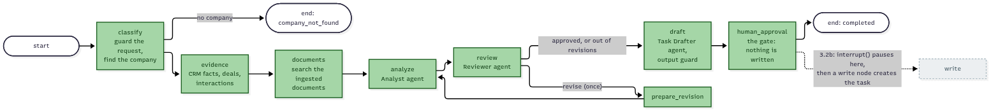

# Stage 3 — LangGraph port: change the inside, keep the outside

> **Level:** beginner friendly; read [Stage 2](02-tools-and-mcp.md) first for the tools the 🟪agent uses. **Reading time:** about 25 minutes.
> **Status:** written. **3.1 (the test split), 3.2a (the graph) and 3.2b (pause and resume) are done; Stage 4 is next.**
> **Roadmap:** [Stage 3](../roadmap.md#stage-3--langgraph-port) · **Decisions:** [ADR 0017](../adr/0017-contract-and-internal-tests.md), [ADR 0018](../adr/0018-langgraph-graph-and-resume.md)

**AI colour code:** 🟪 concept · 🟦 framework or tool · 🟩 data store or service · 🟧 model. Unmarked technical terms are ordinary software. [A to Z list](../ai-terms.md)

## In one minute

Stage 3 rebuilds the account follow-up 🟪agent's inner workings as a 🟦LangGraph graph. Before touching it, 3.1 answers one question: **how will we know the rebuild did not change what the 🟪agent does?** Think of renovating a shop while it stays open. You do not photograph the shelves; you write down what a customer can see and do at the counter, and check it again after each day's work.

| Shop idea | Project idea | What we built |
| --- | --- | --- |
| What a customer can see and do at the counter | **API-contract tests** | `tests/contract/`: the agent's HTTP behaviour, checked over HTTP |
| Notes about how the back room is arranged | **Internal tests** | `tests/agent_internals/`: they may change when the back room does |
| Two doors you may prop open for testing: the delivery door and the phone line | **Two seams** | A fake model and canned document 🟪chunks; nothing else is faked |
| A rule that stops anyone moving the counter notes into the back room | **A boundary check** | `test_contract_boundary.py` fails if a contract test reaches inside |

## The big picture (3.1)


<sub>Diagram source: [stage3-test-boundary.mmd](../diagrams/stage3-test-boundary.mmd)</sub>

---

## Concept 1 — Contract tests and internal tests

**The problem.** "The tests pass unchanged after the rewrite" is a strong claim, but only if the tests do not depend on the thing being rewritten. The old 🟪agent tests called workflow functions directly and replaced about 27 internals. Rewrite the workflow and they would break, for reasons that say nothing about whether the agent still behaves.

**The idea.** Sort tests by *what they are allowed to know*:

| | Contract test | Internal test |
| --- | --- | --- |
| Talks to | The HTTP API only | Functions inside the code |
| Knows about | Responses, statuses, the shape of the trace, limits | How the code is arranged |
| After the port | Must pass **unchanged** | May be rewritten or deleted |
| Failure means | The behaviour changed | The structure changed |

A worked example. This contract test says: *recommending never writes a task*.

```python
async def test_recommending_never_writes_a_task(api, use_model):
    use_model()
    before = await task_count()
    await run(api)                       # POST /api/v1/agent/recommend
    assert await task_count() == before  # the tasks table is unchanged
```

It does not care whether the workflow is a loop of `await` calls or a graph. That is the point.

### What the contract pins down (26 cases)

| Area | Examples |
| --- | --- |
| Shape | Exactly these top-level keys; each trace step has exactly these seven keys, numbered 1..n; the last step is the confirmation gate |
| Order | The agents are asked analyst, reviewer, task drafter; a revision shows up as `Analyst agent (revision)` |
| Limits | Revisions are bounded (and an unapproved result is *flagged*, not hidden); the step limit gives `budget_exceeded`; the time limit gives `timed_out` |
| Safety | Recommending never writes; an injected instruction is flagged and never reaches the model; a made-up citation (`E99`) cannot be approved; a task note is neutralized before it is stored |
| Confirm | Declining writes nothing; confirming writes exactly one task and an audit row; an unknown company is a 404; `confirm` is required (no silent default to "write") |
| Failure | No model, or no 🟪embeddings key: a `503` with the reason, nothing written |

### The two seams

A contract test cannot call the internet or a real model, so it replaces exactly two things:

| Seam | Stands for | Replaced by |
| --- | --- | --- |
| `app.routes.agent.make_llm` | The model, called with the role `analyst`, `reviewer` or `task_drafter` | A scripted fake that answers by role |
| `app.mcp.tools.retrieve_relevant_chunks` | Document 🟪retrieval (embeddings and the 🟪vector store) | A few canned 🟪chunks |

Everything else is the real thing: the FastAPI app, the Postgres demo data, the 🟪guardrails, the limits (set with the `AGENT_*` settings), the trace. **The port must keep both seams.** Only `tests/contract/conftest.py` may name them.

### A rule that is checked, not just written

`tests/test_contract_boundary.py` fails if a contract test imports application code, patches anything, or names a seam outside `conftest.py`; if the seams in code differ from the table in `tests/README.md`; if a documented seam no longer exists; or if a test file is missing from the README's list. We proved it works the way we proved the tests work, by breaking things on purpose:

| We broke | Result |
| --- | --- |
| Renamed the trace step `awaiting_user_confirmation` in the workflow | 1 contract test failed (the trace order test) |
| Added a contract test that imports the workflow and patches it | The boundary check failed twice (imports, patching) |

### Something the contract found

Writing "what the API does when the model is unavailable" showed that it did **not** do anything sensible: a real analysis with no keys returned an opaque `500 Internal Server Error`, while `/chat/tools` already gave a readable "set the key" `503`. The agent API now answers `503` with the reason (a new `EmbeddingsUnavailableError` joins `LlmUnavailableError`), the contract pins it, and the web app shows the text instead of "The agent stopped: undefined".

> [!NOTE]
> **What the contract cannot prove.** The model is a fake, so it says nothing about what a *real* model does with the 🟪prompts (that is the evaluation suite's job), and it covers only the agent API, not `/chat/*`. The model's JSON reply format (`action`, `rationale`, `evidence`; `verdict`, `reasons`; `task_note`) is part of the seam: if the graph changes what it asks the model for, the fake must change too.

### Lessons

> [!IMPORTANT]
> 1. **Decide what "unchanged" means before you change anything.** A contract is a list of observable behaviours, not a feeling.
> 2. **Fake the edges, not the middle.** Two seams at the model and the retrieval; the rest runs for real.
> 3. **Enforce the boundary with a test.** A rule that only lives in a README erodes.
> 4. **Include failure in the contract.** The first thing writing it down found was a bad failure.
> 5. **Prove a test can fail.** We broke the code and watched the right test go red.

## Concept 2 — The agent as a graph (3.2a)

**The problem.** Today's 🟪agent is a long function with a `while` loop. To know what the agent does, you read the whole function; to add a step, you edit the middle of it.

**The idea.** A 🟦LangGraph graph writes the shape down: each step is a **node** (a small function), each arrow is an **edge**, and a **state** (a plain dictionary) is what the nodes hand to each other. A node returns only what it changed.



<sub>Diagram source: [stage3-agent-graph.mmd](../diagrams/stage3-agent-graph.mmd)</sub>

| Shop idea | Project idea | In the code |
| --- | --- | --- |
| A job card that travels with the order | **State** | `AgentState` in `app/agent/workflow.py` |
| One counter per job | **Node** | `classify`, `evidence`, `documents`, `analyze`, `review`, `draft`, `human_approval` |
| The arrows on the floor plan | **Edges** | `build_graph()`; the loop is `review` to `prepare_revision` to `analyze` |
| The till and the stopwatch, which stay with the manager and never go on the job card | **`RunContext`** | the model call, the limits and the trace: not saved with the state |

**What did not change.** The 26 contract tests pass unchanged: same response, same trace, same limits, same 503s. The steps and the 🟪guardrails are the same code moved into nodes. The graph ends at `human_approval` and writes nothing; confirming is still the separate `/agent/confirm`.

**Why the state must be plain data.** In 3.2b the state is saved in Postgres so a paused run can survive a restart. A test (`test_the_state_is_plain_data_so_a_checkpointer_can_save_it`) already checks the state is JSON, so 3.2b does not discover a problem late. The trace lives in `RunContext` for a second reason: when a limit stops the run with an exception, the steps taken so far are still reported.

**Rule to remember.** *A graph is a drawing you can run: change the drawing, not the function.*

## Concept 3 — Pause, save, resume (3.2b)

**The problem.** Until now "wait for the user" meant the request simply ended and the run was forgotten; `/agent/confirm` knew nothing about it. If the API restarted between the two calls nothing was lost, because nothing was kept either, but the approval was never really part of the 🟪agent.

**The idea.** The gate becomes a real step. `human_approval` calls `interrupt()`: the 🟦LangGraph run stops, and the 🟪checkpointer saves the whole state in Postgres. Later `/agent/confirm` resumes that saved run with the user's answer (`Command(resume=...)`). Only the `write` node, after a "yes", creates the task. A "no" ends the run without writing.

| Shop idea | Project idea | In the code |
| --- | --- | --- |
| Putting an order in the "waiting for customer" drawer, written on paper, not remembered | **Checkpoint** | `app/agent/checkpoint.py`: LangGraph's Postgres saver and its own tables |
| The order number on the drawer label | **Thread id** | `thread_id(company, note)`: a hash both endpoints can recompute |
| The customer says yes, you pull the order and finish it | **Resume** | `resume_run()` in `app/agent/workflow.py` |

**Why a derived id.** The API contract has no run id (`/recommend` has exact keys; `/confirm` takes three fields), and the 26 contract tests must pass unchanged. So both endpoints compute the id from what the user sees: the company name and the proposed note. If no saved run matches (an edited note, a restart before 3.2b, a different company name such as "Acme" instead of "Acme Fabrication"), `/confirm` does what it always did: it writes directly. The worst case is today's behaviour. See [ADR 0018](../adr/0018-langgraph-graph-and-resume.md), including its 3.2b amendment: the pause lives in a second small graph, because the id is only known once the note is drafted.

**The proof.** `test_a_paused_run_survives_an_api_restart` pauses a run, throws away the pool, the saver and the compiled graph (an "API restart"), builds new ones over the same Postgres and resumes: exactly one task is written. `test_confirm_resumes_the_run_that_recommend_paused` does the same over HTTP.

**Rule to remember.** *Save the state, not the process: anything that survives a restart is data in a database.*

---

## Code tour: what changed in 3.1, and why

Bright green is new in this sub-stage, amber is an existing module that changed, grey is existing and untouched (Stages 0 to 2 are collapsed to one grey box). Markers in the tables: 🟢 new, 🟡 changed, ⚪ earlier.


<sub>Diagram source: [stage3-module-map.mmd](../diagrams/stage3-module-map.mmd)</sub>

### New files

| | Added in | File | What it is for | Names to look at | Used by |
| --- | --- | --- | --- | --- | --- |
| 🟢 | 3.1 | [`tests/contract/conftest.py`](../../apps/api-py/tests/contract/conftest.py) | The two seams, the scripted model, the real-app client, cleanup of test tasks | `SEAMS`, `ScriptedModel`, `use_model`, `api` | The contract tests |
| 🟢 | 3.1 | [`tests/contract/test_agent_recommend.py`](../../apps/api-py/tests/contract/test_agent_recommend.py) | The contract of `/agent/recommend` | `test_a_completed_run_has_exactly_the_documented_shape` | CI |
| 🟢 | 3.1 | [`tests/contract/test_agent_confirm.py`](../../apps/api-py/tests/contract/test_agent_confirm.py) | The contract of `/agent/confirm` | `test_declining_writes_nothing` | CI |
| 🟢 | 3.1 | [`tests/test_contract_boundary.py`](../../apps/api-py/tests/test_contract_boundary.py) | Enforces the boundary rules | `documented_seams()` | CI |
| 🟢 | 3.1 | [`tests/README.md`](../../apps/api-py/tests/README.md) | The three kinds of test, the seams, every test file classified | | Readers, the boundary check |
| 🟢 | 3.1 | [ADR 0017](../adr/0017-contract-and-internal-tests.md) | The decision | | Readers |

### Existing files that changed, and what changed

| | Changed in | File | Change |
| --- | --- | --- | --- |
| 🟡 | 3.1 | `tests/agent_internals/` (4 files, moved) | `test_agent_workflow`, `test_agents`, `test_agent_policies`, `test_agent_route`: unchanged content, new home, marked as "may change in 3.2" |
| 🟡 | 3.1 | `app/routes/agent.py` | `make_llm()` named as the model seam; `503` with the reason when the model or 🟪embeddings are unavailable |
| 🟡 | 3.1 | `app/rag/embeddings.py` | `EmbeddingsUnavailableError`; Google's reply body no longer reaches API callers (it is logged) |
| 🟡 | 3.1 | `app/routes/documents.py`, `tests/test_documents_search.py` | Use the new error type |
| 🟡 | 3.1 | `justfile`, `.github/workflows/ci.yml`, `pyproject.toml` | `just test-contract`, `just test-internal`, a separate CI step, the `contract` marker |
| 🟡 | 3.1 | Web: `AgentRunPanel.tsx`, `types/index.ts` and a new test | Shows the API's error text |
| ⚪ | 0 to 2 | workflow, 🟪agents, policies, 🟪guardrails, 🟦MCP, gateway | Not touched |

### Added in 3.2b and 3.2a

| | Added in | File | Change |
| --- | --- | --- | --- |
| 🟡 | 3.2a | `app/agent/workflow.py` | Rewritten as a graph: `AgentState`, `RunContext`, eight nodes, `build_graph()`. Same behaviour, same module and entry point (`run_account_review`) |
| 🟡 | 3.2a | `tests/agent_internals/test_agent_workflow.py` | Two graph tests: the node list and the loop, and "state is plain data" |
| 🟡 | 3.2a | `pyproject.toml`, `uv.lock` | `langgraph` (and the packages it needs) |
| 🟢 | 3.2a | [`docs/diagrams/stage3-agent-graph.mmd`](../diagrams/stage3-agent-graph.mmd) | The graph |
| 🟢 | 3.2b | `app/agent/checkpoint.py` | The Postgres 🟪checkpointer (pool, `setup()`), and `thread_id()` |
| 🟡 | 3.2b | `app/agent/workflow.py` | `build_graph()` is now part 1 (ends at `draft`); new `build_approval_graph()` (`human_approval` with `interrupt()`, `write`); `resume_run()`; `run_account_review()` saves the paused run |
| 🟡 | 3.2b | `app/routes/agent.py`, `app/main.py` | `/confirm` resumes the paused run, or falls back to the direct write; the pool is closed at shutdown |
| 🟡 | 3.2b | `tests/agent_internals/` | Pause, resume, decline, edited note, restart-survival; an HTTP test of recommend then confirm |
| 🟡 | 3.2b | `pyproject.toml`, `uv.lock` | `langgraph-checkpoint-postgres`, `psycopg-pool` |
| 🟢 | 3.2a | [ADR 0018](../adr/0018-langgraph-graph-and-resume.md) | The graph, and the plan for pause and resume |

### A good reading order

1. **`tests/README.md`**: the whole idea on one page.
2. **`tests/contract/conftest.py`**: the two seams, and nothing else faked.
3. **`tests/contract/test_agent_recommend.py`**: read only the test names; they are the contract in sentences.
4. **`tests/test_contract_boundary.py`**: how a rule becomes a check.
5. **`app/routes/agent.py`, `make_llm()`**: the seam in the production code.

## What this stage added to the tech stack

| Tool | What it does in plain words | Where to look |
| --- | --- | --- |
| **pytest markers** (already used) | Label tests so you can run a group: `pytest -m contract` | `apps/api-py/pyproject.toml` |
| **httpx `ASGITransport`** (already used) | Calls the FastAPI app in-process over a real HTTP interface, without opening a port | `apps/api-py/tests/contract/conftest.py` |
| **🟦LangGraph** | Writes the 🟪agent's steps as a graph of nodes with a saved state, so it can stop and continue | `apps/api-py/app/agent/workflow.py` |
| **🟦LangGraph Postgres 🟪checkpointer** (`langgraph-checkpoint-postgres`, `psycopg-pool`) | Saves a paused run in Postgres, in tables the library creates itself | `apps/api-py/app/agent/checkpoint.py` |

## Glossary

- **API contract**: the behaviours of an API that callers can rely on (responses, statuses, shapes, limits), as opposed to how it is built inside.
- **Contract test**: a test that checks the API contract and nothing about the inside.
- **Internal test**: a test of how the code is arranged inside; it may change when the code is rewritten.
- **Seam**: a place where a real part can be swapped for a stand-in without changing the code around it.
- **Fake**: a simple stand-in used in tests, here a scripted model and canned document 🟪chunks.
- **Port (a rewrite)**: rebuilding something on a new foundation while keeping its behaviour.
- **Boundary check**: a test that enforces a rule about the tests themselves.
- **Graph, node, edge**: the 🟪agent drawn as boxes (nodes, each a small function) joined by arrows (edges).
- **State**: the plain dictionary the nodes hand to each other; a node returns only what it changed.
- **`interrupt()`**: the 🟦LangGraph call that stops a run at a node and waits for an answer.
- **Checkpoint, 🟪checkpointer**: a saved copy of the state; the checkpointer is what writes it, here to Postgres.
- **Thread id**: the label a saved run is stored under; here a hash of the company name and the proposed note.
- **Resume**: continuing a saved run with the user's answer (`Command(resume=...)`).

## Check your understanding

<details><summary>1. Why do the contract tests have to "pass unchanged" through the 🟦LangGraph port?</summary>

If they had to change, they could no longer show that the behaviour stayed the same. A contract test that passes before and after, without edits, is evidence that what a caller sees did not change.
</details>

<details><summary>2. What is the difference between a contract test and an internal test, in one sentence each?</summary>

A contract test talks only HTTP and checks what a caller can see, so it must survive a rewrite. An internal test calls functions inside the code, so it describes the current structure and may be rewritten with it.
</details>

<details><summary>3. Which two things do the contract tests fake, and why only those?</summary>

The model and document 🟪retrieval, because those need the internet, a key or a 🟪vector store. Faking anything more would hide real behaviour (the database, the 🟪guardrails, the limits) that the contract is supposed to cover.
</details>

<details><summary>4. A contract test fails after the port. What does that tell you?</summary>

That the port changed behaviour a caller can see. Either the port has a bug, or the behaviour was meant to change, in which case the contract is changed on purpose, in the open, with a reason.
</details>

<details><summary>5. How is the rule "contract tests do not reach into internals" enforced?</summary>

By `test_contract_boundary.py`, which fails if a contract test imports application code, patches anything, or names a seam outside `conftest.py`, and also checks that the seams in code match the README table and that every test file is classified.
</details>

<details><summary>6. What did writing the contract reveal, and what happens now?</summary>

A real analysis with no model or 🟪embeddings key returned an opaque 500. It now returns a 503 with the reason, the contract tests pin that, and the web app shows the message.
</details>

<details><summary>7. What can these tests not prove?</summary>

What a real model does with the 🟪prompts, and anything outside the 🟪agent API (the chat modes). The model is a fake and its JSON reply format is part of the seam.
</details>

<details><summary>8. Why is the agent drawn as a graph and not left as a function with a loop?</summary>

The drawing and the code are the same thing, so what the agent does can be read in one place and changed by editing the drawing: add a node, move an arrow. The one loop (review sends analyze back once) is a single arrow you can see.
</details>

<details><summary>9. Why does the state have to be plain data, and where do the model call, the limits and the trace live?</summary>

The 🟪checkpointer saves the state in Postgres, and only plain values (strings, numbers, lists, dictionaries) can be saved. Things that cannot be saved or must survive an exception live in `RunContext`, outside the state; a test keeps the state JSON-clean.
</details>

<details><summary>10. The API has no run id. How does /agent/confirm find the run that /agent/recommend paused?</summary>

Both compute the same thread id from the company name and the proposed note. If no saved run matches (an edited note, a different company spelling), /confirm writes directly, as it always did, so the worst case is the old behaviour.
</details>

<details><summary>11. Why is the agent two graphs and not one?</summary>

The thread id comes from the drafted note, which exists only after the agent has run, but a LangGraph run needs its thread id before it starts. So part 1 (question to draft) runs unsaved, and part 2 (the gate and the write) starts from part 1's finished state under the derived id.
</details>

<details><summary>12. How do we know a paused run survives a restart?</summary>

`test_a_paused_run_survives_an_api_restart` pauses a run, throws away the connection pool, the saver and the compiled graph, builds new ones over the same Postgres and resumes: exactly one task is written.
</details>

## Further reading

- Martin Fowler, "Test Double": <https://martinfowler.com/bliki/TestDouble.html>
- Michael Feathers, *Working Effectively with Legacy Code* (characterization tests): <https://michaelfeathers.silvrback.com/characterization-testing>
- pytest, markers: <https://docs.pytest.org/en/stable/how-to/mark.html>
- 🟦LangGraph (the subject of 3.2): <https://langchain-ai.github.io/langgraph/>
