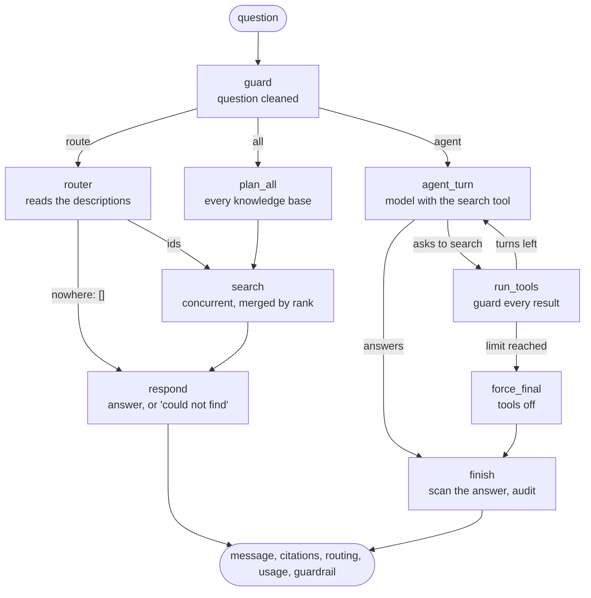

# Extension E1 — Multi-source RAG: more than one knowledge base

> **Level:** beginner friendly; read [Stage 4](04-retrieval-upgrade.md) first (it explains how one collection is searched). **Reading time:** about 15 minutes.
> **Status:** E1.1 (🟪knowledge bases) and E1.2 (🟪routing strategies) written. E1.3 (a comparison) is planned.
> **Roadmap:** [Extensions after parity](../roadmap.md#extensions-after-parity-from-2026-11-13) · **Decisions:** [ADR 0029](../adr/0029-knowledge-bases.md), [ADR 0030](../adr/0030-multi-source-strategies-as-a-graph.md) · **List of Python-only additions:** [python-extensions](../python-extensions.md)

**AI colour code:** 🟪 concept · 🟦 framework or tool · 🟩 data store or service · 🟧 model. Unmarked technical terms are ordinary software. [A to Z list](../ai-terms.md)

## In one minute

Until now the application searched **one** pile of documents: the CRM's emails, notes, tickets and contracts. A real assistant often has to look in more than one place: the CRM, and also a product handbook, a policy library, another business's manual. That is **🟪multi-source RAG**. It has two halves: holding several corpora so they do not disturb each other (this guide, E1.1), and deciding **where to look** for a given question (E1.2).

**Not the same as multimodal 🟪RAG.** Multimodal RAG is *one* index that holds many kinds of content (text, images, video). Multi-source RAG is *several* indexes. Each of them can be multimodal.

| Library idea | Project idea | In the code |
| --- | --- | --- |
| A library with several separate sections | A **🟪knowledge base**: an id, a description and its own 🟩Qdrant collection | `app/rag/knowledge_bases.py` |
| The "General" section, always there | The built-in `crm` knowledge base: the existing collection, unchanged | `QDRANT_COLLECTION` |
| A new section that arrives on its own trolley | An extra knowledge base, ingested by its own function and never touching the others | `ingest_knowledge_base()` |
| A librarian who only searches the shelf you point at | Searching one knowledge base: the ordinary 🟪retrieval, aimed at its collection | `search_knowledge_base()` |
| A sign on each section saying what is inside | The **description**: what a router (E1.2) reads to choose a section | `KNOWLEDGE_BASES` setting |

```
 POST /documents/ingest ───────────▶  crm            (collection document_chunks)
 POST /knowledge-bases/agri-supply/ingest ▶  agri-supply   (collection document_chunks_agri_supply)

 POST /knowledge-bases/crm/search ─────────▶ looks only in document_chunks
 POST /knowledge-bases/agri-supply/search ─▶ looks only in document_chunks_agri_supply
```

## Concept 1 — One collection per corpus

Two ways to hold two corpora: put everything in one collection and tag each 🟪chunk with its corpus (then *filter* at search time), or give each corpus its own collection. We use separate collections, for three reasons that all come from the corpus's **lifecycle**:

- **Re-ingesting the CRM documents drops and recreates its collection.** If the second corpus lived inside it, it would be wiped every time.
- **The extra corpus must not leak into the CRM's own bookkeeping**: the `documents` table, the ingestion runs and the counts the API contract checks (19 documents, 33 chunks).
- **Isolation becomes structural.** A search of one 🟪knowledge base cannot return another's chunks because it never looks there; there is no filter to forget.

A second benefit: each collection records the 🟪embedding model that built it, so a corpus built with an older model is noticed on its own and the message says which route to call to fix it.

## Concept 2 — Aim the retriever, do not copy it

🟪Retrieval ([Stage 4](04-retrieval-upgrade.md)) is a set of module functions that find "the collection" through one helper, `collection_name()`. For a 🟪knowledge base we do not write a second retriever; we **point the first one somewhere else for a moment**:

```python
with using_collection("document_chunks_agri_supply"):
    chunks = await retrieve_relevant_chunks("How long must workers stay out after spraying?")
```

Inside the block, `collection_name()` returns the knowledge base's collection, so 🟪hybrid search, the similarity floor, the optional 🟪reranker and the embedding-model check all apply, with no change to them. The target travels in a **`ContextVar`**, Python's task-local variable: each asyncio task sees only its own value, so two requests for two knowledge bases running at the same moment cannot cross (a test runs exactly that). The two small caches in retrieval (the point count, the model check) are keyed by collection name for the same reason.

## Concept 3 — The description is data for the router

An extra 🟪knowledge base is configured with a **description** of what is inside (`KNOWLEDGE_BASES`, a JSON list). Nothing reads it yet in E1.1 except the list route; in E1.2 a router (or the model itself) will read the descriptions to decide which corpus can answer a question. That makes the description an *interface*: vague descriptions will give bad routing. The sample corpus (eight synthetic farm-supply documents) deliberately shares some vocabulary with the CRM documents (renewal, pricing, support, delivery), so a router cannot decide on vocabulary alone.

## Concept 4 — Idioms worth noticing (Python)

- **`Depends` with a path parameter** turns `{kb_id}` into the object or a 404 once, for every route.
- **A pydantic model** is the search body, its limits and its 422 messages in one class; `pydantic-settings` parses the whole `KNOWLEDGE_BASES` list of nested models from one JSON variable.
- **An in-process 🟩Qdrant** (`:memory:`) runs the real engine in the test process, so the tests exercise real 🟪vector search with no container and no key.

## How to try it

```bash
just up && just seed                                          # the stack (API on localhost:8001) and the CRM documents (needs the embedding key)
just kb-ingest agri-supply                                    # the second corpus: 8 documents
just kb-list                                                  # two rows: crm 33 chunks, agri-supply about 13
just kb-search agri-supply "How long must workers stay out of a block after spraying?"
just kb-search crm "How long must workers stay out of a block after spraying?"
```

Notice: the first search returns only `knowledge-bases/agri-supply/...` sources; the second returns only CRM documents (probably weak matches); ingesting the CRM documents again leaves the farm-supply count unchanged.

## E1.2 — Three ways to decide where to search

`POST /api/v1/chat/multi` answers a question from the 🟪knowledge bases, with a `strategy`:

| Strategy | Who decides | Model calls | What it costs and risks |
| --- | --- | --- | --- |
| `route` (default) | A 🟪router model reads each description and picks the corpora | 1 + the answer | A wrong pick hides a corpus; so an unreadable answer means *search everything*, and only an explicit `[]` means *nowhere* |
| `all` | Nobody: every corpus is searched and the results merged | the answer only | A search per corpus, and weak sources from the corpora that cannot answer |
| `agent` | The model, through a `search_knowledge_base(knowledge_base, query)` tool | one per turn | It can search twice, with its own queries; a small model may stop too early or never try the other corpus |



| Piece | File | Job |
| --- | --- | --- |
| The graph and the route | `app/routes/multi_chat.py` | the nodes, the edges, the tool loop, the guard, the response |
| Router and merge | `app/rag/multi_source.py` | read the router's JSON safely, search several corpora concurrently, fuse by rank, rerank |

### Concept 5 — A graph that decides, not only a graph that runs

The account 🟪agent of Stage 3 is a sequence with one loop. This graph's job is **branching**: a conditional edge picks the strategy, another the router's verdict, and the agent's tool loop is a visible cycle with a limit (`agent_turn` → `run_tools` → `agent_turn`, or `force_final`). The shape is declared in `build_graph()`, so it can be read, drawn and tested (a test asserts the cycle exists) instead of being buried in a `while`.

### Concept 6 — A 🟪query routing router is a classifier, so plan for it being wrong

Reading the descriptions is a classification, and small models are weak classifiers. The design makes the router's failure harmless: an unreadable answer, or one that names only ids that do not exist, falls back to searching everything and says so in `routing.reason`. Only a deliberate empty list means "nowhere".

### Concept 7 — Merge by position, not by score

🟪Cosine scores from two corpora are not on one scale. 🟪Reciprocal rank fusion uses positions only (the same function that merges 🟪hybrid search); with no 🟪reranker it is a round robin, with one the reranker reads the question and each candidate together and does the real ordering.

### Concept 8 — Hand-written tool nodes, on purpose

🟦LangGraph has a prebuilt tool node and 🟦LangChain a 🟪prebuilt agent. Stage 5.5 measured the prebuilt agent with a small model: it answered before calling any tool on 12 of 13 runs. This loop must also number sources across calls, guard every result and treat the model's arguments as untrusted, so the nodes are ours and LangGraph declares the shape. [ADR 0030](../adr/0030-multi-source-strategies-as-a-graph.md) has the reasoning.

### How to try E1.2

```bash
just up && just seed && just kb-ingest agri-supply          # the stack and both corpora (needs the embedding and chat keys)
just multi "How long must workers stay out of a block after spraying?"                 # route (the default)
STRATEGY=all just multi "What is the renewal notice period?"                           # both corpora, merged
STRATEGY=agent just multi "Compare how our CRM customers handle renewals with the farm-supply renewal terms"
STRATEGY=everything just multi "x"                                                     # 422 literal_error
```

Notice: in `route` read `routing.reason`; in `all` the citations come from both corpora, numbered 1 to 4; in `agent` read `routing.toolsUsed` (each search with its knowledge base and query) and see how the numbering continues across calls. "Renewal" and "pricing" exist in both corpora on purpose.

## E1.3: the strategies on 24 questions

The same 24 labelled questions as the Java edition, recorded once and replayable without keys:

```bash
just eval-multi          # the table, from evals/knowledge-bases/recorded.json
just eval-multi-check    # fails if a count differs from baseline.json (also runs in CI)
```

Right sources found on the 20 answerable questions: `route` 19, `all` 20, `agent` 17. Citations from the wrong corpus: 31 of 87, 43 of 91, 26 of 126. Off-topic questions with no sources cited: 1, 0 and 0 of 4. The Java edition's table is within a couple of questions of this one on every row; the differences are single-run choices of a small model (a router that picked one corpus, an agent that searched only the CRM). Numbers, differences and limits: [ADR 0032](../adr/0032-multi-source-strategy-results.md).

Notice: open `recorded.json`, find `mq-18` under `agent`, and see the same query repeated against the CRM only.

## What comes next

The recording used the 0.45 floor. A re-record with the 0.60 floor (ADR 0031), and a floor for the farm-supply corpus like the Java edition's, are separate steps.
