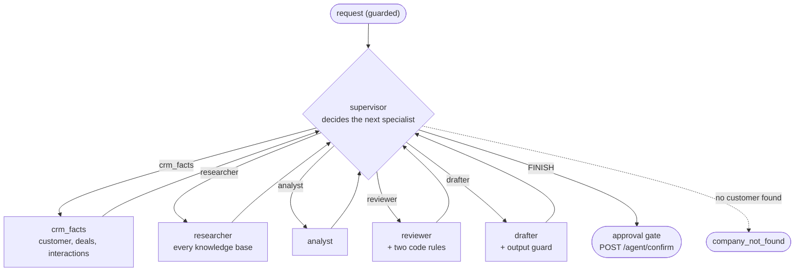
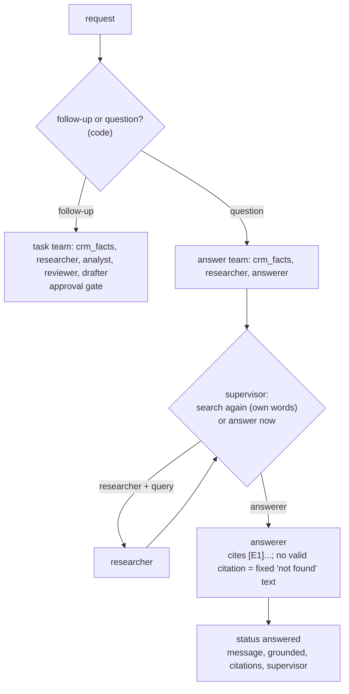

# Stage E3: a supervisor with specialist agents (Python extension)

The Python twin of the Java edition's E3 (see [python-extensions.md](../python-extensions.md)). Decisions: [ADR 0033](../adr/0033-supervisor-with-specialist-agents.md). Cut into slices: **E3.1** the supervisor graph, **E3.2** an answer team and the supervisor's own search words (below), **E3.3** a comparison with the fixed pipeline.

**AI colour code:** 🟪 concept · 🟦 framework or tool · 🟩 data store or service · 🟧 model. Unmarked technical terms are ordinary software. [A to Z list](../ai-terms.md)

## E3.1: `POST /api/v1/agent/supervise`



| Piece | File | Job |
| --- | --- | --- |
| The graph, the rules, the specialists | `app/agent/supervisor.py` | supervisor node, `allowed()`, the five specialists |
| The route | `app/routes/supervise.py` | `POST /agent/supervise`, same request and errors as `/agent/recommend` |
| The setting | `app/config.py` | `SUPERVISOR_MAX_TURNS` (default 10) |
| Reused | `app/agent/workflow.py` nodes, `agents.py`, the approval graph | the specialists' work, the guard, the pause |

### What the supervisor may do

Each turn code builds the list of **allowed** specialists; the model chooses from it only when there is more than one.

| State | Allowed |
| --- | --- |
| customer not loaded | `crm_facts` |
| no customer found | `FINISH` |
| no recommendation yet | `analyst`, and `researcher` (at most twice) |
| a recommendation, not reviewed | `reviewer` |
| reviewed and approved, or out of revisions | `drafter` |
| reviewed and sent back, revisions left | `analyst`, and `researcher` |
| note written | `FINISH` |

An unreadable or disallowed answer is replaced by the first allowed entry (the fixed pipeline's next step) and recorded with the reason.

### Concepts

1. **Pipeline versus supervisor.** A pipeline has the order in code; a supervisor has the order in a model's turn-by-turn decisions. The supervisor is more flexible and costs more (not measured here until E3.3).
2. **A model coordinating models needs rails.** The supervisor is itself a model, so preconditions, caps and limits are code, and a bad answer degrades to the pipeline instead of derailing the run.
3. **Hand control back.** Every specialist returns to the supervisor, so it sees the new state before choosing again. In 🟦LangGraph that is one edge from each specialist back to the supervisor node.
4. **Do not ask when there is no choice.** One allowed specialist means no model call.
5. **Specialists are reusable.** Four of the five are the account 🟪agent's own nodes; the fifth (the researcher) uses the multi-source search of E1. Adding a specialist is adding a node, a precondition and a line in the 🟪prompt.
6. **Decisions are data.** The response lists every turn: who chose (`supervisor` or `code`), why, what was allowed, and what the model proposed when it was overridden.
7. **State is versioned where it must be.** A review is of one recommendation: `rec_version` and `review_version` stop the drafter running on a review of an earlier proposal.
8. **The human gate stays.** However the work was coordinated, nothing is written until `POST /agent/confirm` with a yes.

### How to try E3.1

```bash
just up && just seed && just kb-ingest agri-supply     # the stack and both corpora (needs the embedding and chat keys)
just supervise "Analyze Acme Fabrication and recommend a next action"
```

Notice: `supervisor.turns` lists each decision. Most say `"source": "code"` and `"reason": "only one choice allowed"`; the turn before the analyst is the real choice (`"source": "supervisor"`), and it may have called the researcher first (look for `search_knowledge_bases` in `trace`). A name the CRM does not have (`Analyze Globex and recommend a next action`) ends at once as `company_not_found` with no model call. Nothing is written until `POST /agent/confirm` (the web app's Confirm button, or the curl in the testing guide).

## E3.2: an answer team and the supervisor's own search words

Decisions: [ADR 0034](../adr/0034-answer-team-and-supervisor-queries.md). The same route, `POST /api/v1/agent/supervise`, now handles two kinds of request. Code decides which team runs (the rule that already separated a follow-up from a simple question, `needs_agent`).



| State of a question | Allowed |
| --- | --- |
| customer not loaded | `crm_facts` |
| no research yet | `researcher` (one choice: no model call) |
| researched | `answerer`, and `researcher` once more (a real choice: the supervisor is asked) |
| answered | `FINISH` |

The response of a question has `status: "answered"`, `message`, `grounded`, `evidence`, `citations` (the evidence items the answer cited), `guardrail`, `llmCalls` and `supervisor`. It has no `proposedTask` and nothing to confirm.

### Concepts

1. **Route to a team, not only to a step.** The supervisor coordinates different sets of specialists depending on the kind of work. The team is chosen in code, because the approval gate must never depend on a model's mood.
2. **A decision with content.** The supervisor does not only pick a name: it can write the words the researcher searches for. Model-written text is still untrusted input: trimmed, capped at 200 characters, only honoured for the researcher, and what it 🟪retrieves is guarded as before.
3. **Fail closed on grounding.** An answer is shown only if it cites evidence that exists; otherwise the fixed "could not find" text is shown and `grounded` is `false`.
4. **No customer is fine for a question** and not for a follow-up: the same specialist, different rules per team.
5. **Decisions stay visible.** `supervisor.turns` records who chose each step, why, and the search words.
6. **What was left out.** Parallel specialists need a reducer for the evidence list; with such short specialists it would only buy latency.

### How to try E3.2

```bash
just up && just seed && just kb-ingest agri-supply          # the stack and both corpora (needs the embedding and chat keys)
just supervise "How long must workers stay out of a block after spraying?"   # a question: the answer team
just supervise "What did Acme Fabrication ask us for?"                       # a question that names a customer
just supervise "Analyze Acme Fabrication and recommend a next action"        # a follow-up: the task team, with the gate
```

Notice: a question returns `status: answered` with `grounded` and `citations`, and no `proposedTask`; `supervisor.turns` shows the researcher chosen by code (one choice) and then the one real choice (answer now, or search again), with the supervisor's own `query` on a turn when it searched again.

## What comes next

**E3.3** compares the supervisor with the fixed pipeline on the Java edition's ten golden cases, recorded once and replayable without keys. It needs a recording with keys, so it waits for the owner's go.
