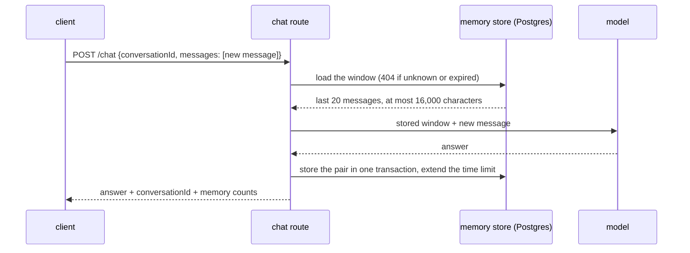

# Stage E4: conversation memory (Python extension)

The Python edition goes first; the Java lab comparison (J8.6) follows the same contract. Decisions: [ADR 0036](../adr/0036-conversation-memory.md). See also [python-extensions.md](../python-extensions.md).

**AI colour code:** 🟪 concept · 🟦 framework or tool · 🟩 data store or service · 🟧 model. Unmarked technical terms are ordinary software. [A to Z list](../ai-terms.md)

## E4.1: the server keeps the history

Until now every chat request carried the whole conversation (1 to 12 messages) and the server forgot it. With **`conversationId`** the server keeps the conversation memory in Postgres and sends the model a **window** of it.

| What | Rule |
| --- | --- |
| Make one | `POST /api/v1/conversations` gives `201 {conversationId, createdAt, lastUsedAt, expiresAt}` |
| Use it | add `"conversationId"` to `/chat`, `/chat/rag`, `/chat/crm`, `/chat/tools` or `/chat/multi`; send only the **new** message; the last message must be from the user |
| Window | the last `MEMORY_MAX_MESSAGES` (20) stored messages, trimmed from the oldest to `MEMORY_MAX_CHARS` (16,000) characters; never starts with an answer |
| Stored | after a success only, the person's message (the **guard-neutralized** text) and the answer, in one transaction |
| Time limit | `MEMORY_TTL_HOURS` (24) after the last stored turn; reads do not extend it |
| Cap | `MEMORY_MAX_CONVERSATIONS` (1,000); creating one beyond it deletes the least recently used |
| Read and delete | `GET` and `DELETE /api/v1/conversations/{id}` (`204`); delete removes the messages at once |
| Errors | unknown or expired: `404` before any model runs; malformed `conversationId` or an assistant-last request: `422` |
| Privacy | the **id is the only access control** (no accounts); content is never logged or traced, only counts |

Without a `conversationId` every endpoint is exactly as before, and the contract tests pass unchanged.

## What the tests prove

`tests/test_memory_store.py` (the window, the time limit, the cap, delete, concurrent turns, against the real Postgres) and `tests/test_chat_memory.py` (a scripted model: the second question sees the first turn, the stored text is the guarded text, 404 before any model call, a failed answer stores nothing, `/chat/multi`).
