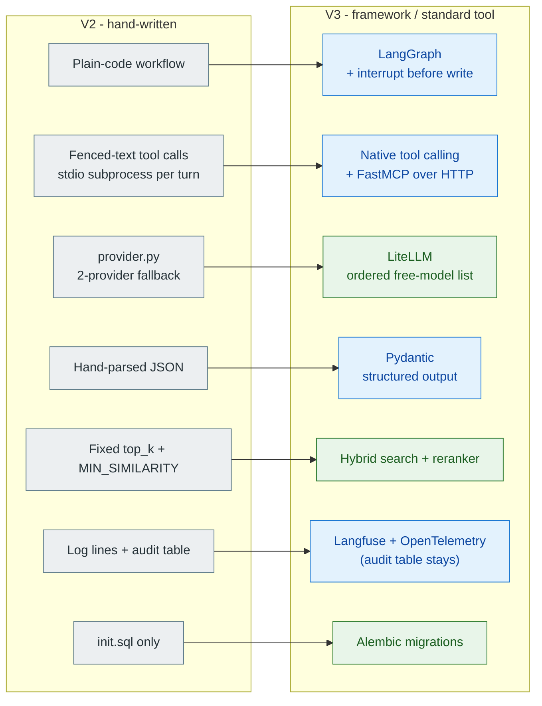
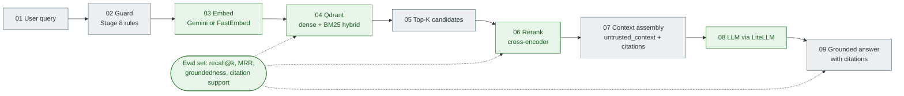
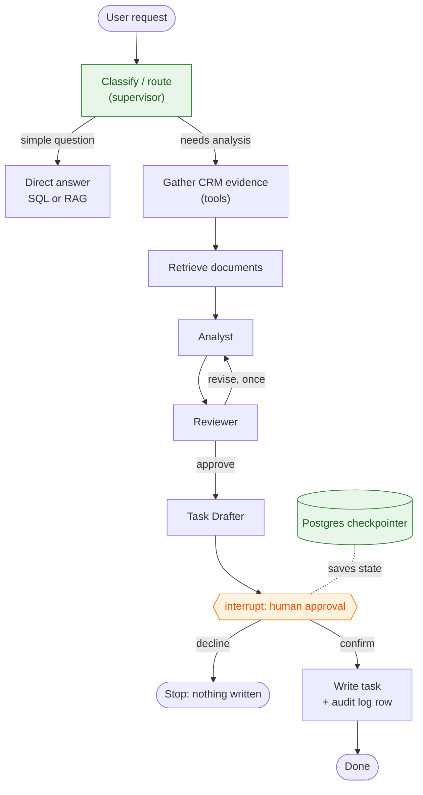

# Customer Compass V3 — Roadmap Draft + Recommendations 1 + Recommendations 2

> Planning note only — not yet committed to any repo. Move into
> `docs/` of the new `customer-compass-v3` repo once that repo exists.

## How to read this document

| Marker | Meaning |
| --- | --- |
| Plain text / tables | The original roadmap (unchanged, including the 2026-10-25 revision) |
| `> 💡 RECOMMENDATION:` (grey quote) | Recommendations-1 (unchanged) |
| `> [!IMPORTANT]` + **🟢 RECOMMENDATION-2** (coloured call-out on GitHub) | **New, added in this document** |
| **Part B** at the end | New standalone material: feedback on the docs and repo, roadmap gaps, tool table, phased plan with exit criteria |

## Revision 2026-10-25 — decisions after V2 closed

V2 (Stages 1–10) is concluded. These decisions change the plan below; where
they conflict with older text, **this section wins**.

1. **Frameworks replace most hand-written plumbing in V3.** Track B is no
   longer "compare, don't replace". V2 stays as the hand-built baseline.
2. **Orchestration: LangGraph.** Human-in-the-loop pauses map to the Stage 10
   confirm gate. Other frameworks (OpenAI Agents SDK, Pydantic AI, CrewAI) are
   not adopted; compare only if there is a specific reason.
3. **Cloud models only.** Ollama, `app/llm/ollama.py`, the local UI option and
   the `ollama` container are removed. Fallback becomes cloud-to-cloud.

> **💡 RECOMMENDATION:** Make the trade-off explicit: free hosted APIs are not open-source; choose “cloud-only free-tier learning” deliberately, and keep provider/model access behind an interface so a local open-weight option can be added later if needed.

> [!IMPORTANT]
> **🟢 RECOMMENDATION-2:** Pick one explicit rule: *the frameworks and tooling must be open source; model APIs may be free-tier hosted.* Put all model access behind **LiteLLM** (ordered fallbacks, retry/backoff, 429 cooldown). A local open-weights model can later be added as one more LiteLLM backend. Details: Part B, T1.

4. **Free tiers only** (no paid budget). Known risk, seen in V2: free models
   rate-limit (HTTP 429) and change availability. Mitigations: a configurable
   list of models across more than one free provider, retry with backoff, and
   mocked models in tests and CI. Check each provider's current free limits
   before relying on them.

> [!IMPORTANT]
> **🟢 RECOMMENDATION-2:** Keep the free-model list in one `models.yaml` (not in docs or code), validated by `pydantic-settings`. Add a **record-and-replay cache** for eval runs so free-tier limits do not make scores noisy, and pin the judge model.
>
> Embeddings are a hidden single point of failure (Gemini free tier). Add an open-source option (**FastEmbed** or sentence-transformers, CPU) and compare it on the eval set. Part B, T4.

5. **CRM grows by three modules** to give agents real data and tools:
   support tickets, contracts and renewals, and meeting/email notes.

### What gets replaced, and what does not

| Area | V2 (hand-written) | V3 |
| --- | --- | --- |
| Agent orchestration | Plain-code workflow (`agent/workflow.py`) | **LangGraph** graph with interrupt-before-write |
| Tool calling | Fenced-text protocol (Stage 9) | Native function calling + official **MCP Python SDK / FastMCP** |
| Model access | `app/llm/` provider, fallback, cloud client | **LangChain chat models** (or LiteLLM for routing/fallback) |
| Agent output parsing | Hand-parsed JSON | **Pydantic** structured output |
| RAG | `retrieve.py`, `embeddings.py` | LangChain or LlamaIndex over the same Qdrant |
| Document ingestion | Markdown only | Docling or Unstructured (PDF, Word, Excel) |
| Guardrails | Rules + LLM guard | Compare ours with Llama Guard / NeMo Guardrails; keep whichever wins |
| Tracing | Log lines + `tool_audit_log` |  **Langfuse** (self-hostable) or LangSmith free tier |
| Evals | promptfoo | Keep promptfoo; add Ragas or DeepEval |

> **💡 RECOMMENDATION:** Establish a small baseline evaluation set before changing the RAG stack; track retrieval precision/recall@k, answer correctness and groundedness, citation support, tool-call correctness, workflow completion, latency, and errors.

> [!IMPORTANT]
> **🟢 RECOMMENDATION-2:** Build the baseline **before** porting anything (a new phase 0): 30–50 retrieval questions, 10 tool-call cases, 10 agent cases, 20 adversarial cases. Run it on V2 and save the report. Without it, "same behaviour" cannot be shown.
>
> Add **retrieval-level** metrics (recall@k, MRR) in plain pytest next to Ragas/DeepEval, and a reranker/hybrid-search test. Part B, section 6.

**Not replaced:** CRM SQL queries, the confirm-before-write rule, the audit
log table, and the domain tests. The Stage 10 tests must pass unchanged
against the LangGraph version to show the behaviour is the same. Pin framework
versions and record why each was chosen (see "Tooling decisions").

### Cloud-only consequences to handle
- Remove Ollama from `docker-compose.yml`, `.env.example`, the model dropdown,
  the Stage 7 fallback path, the LLM guard and tests; update the docs.
- No offline development; tests must mock the model.
- Timeouts and step limits (Stage 10: 8 steps, 180 s) were set for a slow local
  CPU model and should be re-measured on cloud models.

> **💡 RECOMMENDATION:** Keep CI deterministic with mocked model responses, and add bounded retries/backoff plus explicit handling for 429s, provider outages, and unavailable free models.

> [!IMPORTANT]
> **🟢 RECOMMENDATION-2:** The Ollama removal list is incomplete. It also touches the **promptfoo judge** (`ollama:chat:qwen2.5:7b`), `evals/compare_guards.py`, `scripts/setup-ollama-cache.sh`, `mcp/client.py`, `rag/embeddings.py`, the web files (`types`, `useChat`, `ChatModeSelector`, `MessageBubble`) and the `GUARD_PROVIDER=ollama` default: about 40 files. Make this the checklist.
>
> Re-measure the 8-step / 180 s limits on cloud models and write the numbers into an ADR. Also decide on **streaming (SSE)** now, because it changes the API contract.
>
> "Stage 10 tests pass unchanged" only works if you split them: *API-contract tests* (must pass unchanged) vs *internal tests* (may change). Today they patch about 27 internals and pick fake answers by looking for the text "Analyst agent" in the prompt.

### New CRM modules and the agents they enable

| Module | Agent / use |
| --- | --- |
| **Support tickets** | Triage agent: classify, route, find similar past tickets |
| **Contracts and renewals** | Renewal-risk agent |
| **Meeting and email notes** | Meeting summarizer agent (feeds the Analyst agent's evidence) |

A supervisor agent routes between these agents and the Stage 10 agents.
Invoices/billing and a separate knowledge base were considered and left out
for now; the Document Researcher agent uses the existing documents.

> [!IMPORTANT]
> **🟢 RECOMMENDATION-2:** Generate the three modules' data with a **seeded script** (fixed seed, versioned) that also emits known-answer questions, so evals have ground truth. Add **Alembic** migrations first.
>
> Tickets and meeting notes carry third-party free text: the classic prompt-injection path. Extend the Stage 8 adversarial set per module and add **Presidio** for PII redaction. Add authentication and per-tool permissions (the deferred Stage 9 item). Part B, T8, T9.

### Revised order
0. New repo from V2; cloud-only models; free-tier model list with fallback.
1. Model layer, native tool calling and MCP SDK.
2. Port Stage 10 to LangGraph with the same API and tests.
3. Add the three data modules and their tools.
4. Grow to 5 agents plus a supervisor.
5. Tracing, evals and the guardrail comparison.

> [!IMPORTANT]
> **🟢 RECOMMENDATION-2:** Insert **Phase 0** before step 0: CI, ruff/mypy/pre-commit, pinned Docker images, Alembic baseline, a real root README, ADR 0001, and the saved V2 eval baseline. Give every later phase 3–5 measurable exit criteria. Full table: Part B, section 6.

## Why a new repo, not a branch

`customer-compass-v2` is being kept as a **clean, linear, closed
learning artifact**: each stage (1 through 9, currently) was hand-built
to understand the underlying mechanics (RAG, CRM routing, guardrails,
cloud/local LLM providers, MCP tool calling) before reaching for a
framework. Bolting new product features and framework-comparison
exercises onto it would blur that focus and make it harder to point
back to as "here's what stage N looked like."

`customer-compass-v3` starts fresh, seeded from v2's final state,
once v2 is considered "done" (Stages 1–10 merged; closed 2026-10-25), seeded from v2's final state. V3's learning goal shifts
from *"build the fundamentals by hand"* to *"how do frameworks/tools
accelerate or change this, and what else can the product do."*

> [!IMPORTANT]
> **🟢 RECOMMENDATION-2:** Create a git tag (for example `v2-final`) before seeding V3 so the baseline is reproducible. Fix the duplicated sentence "seeded from v2's final state" and change "stages 1 through 9" to "1 through 10". Fold the 2026-10-25 revision into the body and date the document once.

## Two tracks within V3

Kept separate because they have different goals — shipping working
features vs. learning by side-by-side comparison — even though they
may touch the same code areas.

### Track A — Product features
Extends what the app can actually do for a user.

- **add-new-company-ui** — UI form + `POST /api/companies` to create
  companies/contacts/deals from the browser (currently seed-only). Would be
  `POST /api/v1/companies` on the FastAPI service.
- **multi-format-doc-ingestion** — PDF (`pypdf`/`pdfplumber`), Word
  (`python-docx`), Excel/CSV (`openpyxl`/`pandas`) support in the
  ingestion pipeline, alongside the current Markdown-only path.
  Tabular data (sheets) likely routed through the structured
  CRM/tool-calling path rather than vector search.

> **💡 RECOMMENDATION:** Prototype Docling first for mixed document formats; keep Excel/CSV facts in structured queries/tools where possible, and preserve source, page/sheet, and chunk metadata for citations.

> [!IMPORTANT]
> **🟢 RECOMMENDATION-2:** Order matters: the add-company form needs migrations first (Alembic), and multi-format ingestion needs the metadata schema first. For the form use React Hook Form + Zod, and add one Playwright test per feature.

- **rag-adaptive-scaling** — explore adaptive top-k (confidence/
  query-length based) instead of the current fixed `top_k=4`; note
  infra-level autoscaling as likely out of scope for a learning repo.

> [!IMPORTANT]
> **🟢 RECOMMENDATION-2:** Replace *adaptive top-k* with a **cross-encoder reranker** score cut-off plus **hybrid search** (dense + BM25) in Qdrant. Your own eval notes say similarity thresholds cannot fix the "plausible-but-uncovered" case; a reranker targets exactly that. Part B, T5.

### Track B — Framework exploration
Reimplements existing hand-rolled pieces using well-known frameworks. As of
the 2026-10-25 revision above, the framework version **replaces** the
hand-written one in V3 (V2 remains the hand-built baseline).

- **LangChain core** — `GoogleGenerativeAIEmbeddings`
  (Google `gemini-embedding-001`, the text → vector embedding model)
  + `QdrantVectorStore` (Qdrant is the vector DB) + `retriever.invoke()` vs. our
  `embeddings.py`/`retrieve.py`; `ChatOpenAI` (pointed at OpenRouter) vs. our
  provider-swap logic in `app/llm`; `ChatPromptTemplate` vs. manual
  f-string prompts; `bind_tools()`/`create_tool_calling_agent()` vs.
  our hand-rolled Stage 9 MCP fenced-text protocol.

> **💡 RECOMMENDATION:** Adopt LangChain where it removes real maintenance work, not as a blanket rewrite; pin versions and compare behavior against V2 tests/evals. Re-embed the corpus if the embedding model changes, because vector spaces may be incompatible.

> [!IMPORTANT]
> **🟢 RECOMMENDATION-2:** Track B is worded as "X vs. our Y" but the revision says frameworks **replace** the hand-written code. Reword it as "replace, and record the before/after in an ADR".
>
> The `create_tool_calling_agent()` mention is likely outdated (LangChain 1.x moved its agent constructors; confirm in the docs for the version you pin). Prefer native structured output with **Pydantic**, and use **LiteLLM** for model routing. Part B, T1–T3.

- **LangGraph** — stateful multi-step agent graphs, applied to the
  RAG-vs-CRM routing logic and any future multi-step agent work.
- **LangSmith** — hosted tracing/evals, compared against our current
  `logger.info(...)` lines + the `tool_audit_log` Postgres table (records each MCP tool call).

> **💡 RECOMMENDATION:** Because the learning constraint is open-source/free tooling, make self-hosted Langfuse the default observability choice; treat LangSmith as an optional comparison, not the baseline. Keep the application audit table regardless.
- **Other frameworks for RAG specifically** (most mature/competitive
  space) — LlamaIndex, Haystack, as alternatives to LangChain for the
  retrieval piece.

### Track C — Multi-agent Agentic AI (planned, builds on v2 Stage 10)

v2 Stage 10 ships 3 agents (Analyst agent, Reviewer agent, Task Drafter
agent) with code-controlled orchestration. V3 extends that to **5 agents**
and uses current industry-standard agent tooling:

| # | Agent | Role in v3 |
| --- | --- | --- |
| 1 | **Evidence Gatherer agent** | Chooses which CRM tools to call to collect facts (a fixed code step in v2). |
| 2 | **Document Researcher agent** | Decides what to search in the document store and when it has enough (a fixed retrieval step in v2). |
| 3 | **Analyst agent** | Reasons over the evidence and recommends an action (as in v2). |
| 4 | **Reviewer agent** | Critiques the recommendation against the evidence (as in v2). |
| 5 | **Task Drafter agent** | Drafts the follow-up task for human confirmation (as in v2). |

- Use a current agent framework (LangGraph is already listed in Track B)
  for orchestration, plus tracing/evals (e.g. LangSmith or an open
  alternative), choosing the latest stable versions and justifying any
  exception (see "Tooling decisions").

> **💡 RECOMMENDATION:** Start with a LangGraph workflow of explicit nodes (classify → gather CRM evidence → retrieve documents → analyze → review → human approval → write); promote a node to a separate LLM-driven agent only when evals show that autonomy improves results.

> [!IMPORTANT]
> **🟢 RECOMMENDATION-2:** Add a **Postgres checkpointer** so a run paused at `interrupt()` survives an API restart, and a **supervisor routing-accuracy metric** so routing mistakes are not blamed on the agents.
>
> Replace the stdio-subprocess-per-chat-turn MCP design with a long-lived **FastMCP** server over streamable HTTP. Part B, T10.

- Consider a richer domain with more tools and data: the revision at the top
  adds three CRM modules (tickets, contracts/renewals, meeting/email notes).
  The V2 seed is ~7 companies and ~16 interactions with one write tool, which
  limits how realistic a 5-agent system can be.
- Keep every write behind human confirmation and the Stage 8 guardrails.

> **💡 RECOMMENDATION:** Add the evaluation and tracing foundation before scaling to five agents; first prove the current three-agent flow, then add one capability at a time and compare quality, cost/usage, latency, and failure rate.

> [!IMPORTANT]
> **🟢 RECOMMENDATION-2:** Make this a rule in the roadmap: *an agent is added only if evals show better quality at acceptable latency and token cost, and each addition gets a one-page ADR with before/after numbers.* Also write down what would make you **stop** (if LangGraph does not beat V2 on the agreed measures).

## Tooling decisions

**Guiding rule:** prefer the latest, industry-standard tools, and write down a reason for any exception.

- **JavaScript package manager: pnpm** (via Corepack, with `packageManager`
  pinned in `package.json`), with `pnpm-workspace.yaml` for any multi-package
  layout. Why: fast installs through a shared store, strict dependency
  resolution (code can only import what it declares), and cleaner monorepo
  support (`--filter`) than npm workspaces. A new repo has no migration cost.
- **v2 stays on npm.** v2 is not migrated; this applies to V3 only.
- Python stays on `uv`.

> **💡 RECOMMENDATION:** Keep the stack intentionally small—LangGraph for orchestration, selective LangChain integrations, Qdrant, Pydantic, FastAPI, promptfoo plus one RAG evaluation library, and self-hosted Langfuse. Avoid adding multiple overlapping frameworks until a measured need appears.

> [!IMPORTANT]
> **🟢 RECOMMENDATION-2:** Add the supporting tools the roadmap does not mention: **Alembic**, **pydantic-settings**, **structlog**, **ruff**, **mypy/pyright**, **pre-commit**, **GitHub Actions**, **Dependabot/Renovate**, **gitleaks**, **pip-audit**, **just**, Docker Compose profiles. Also a "not adopted" list (CrewAI/AutoGen in the main path, Kubernetes, Kafka, fine-tuning). Full table: Part B, section 5.

## Explicitly NOT in V3

- **docs-only-audit-pr** — stays in v2. It's about restricting v2's
  *own* docs to their actual completed-stage content, so it belongs
  to v2's closing housekeeping, not v3's new work.

## Future domain expansion considerations (possibly a separate repo, not V3)

V3 (above) extends the **existing small CRM domain** with more
features and framework comparisons. Separately, there's an open
question of outgrowing the CRM domain itself to practice agentic AI
at a scope closer to what AI/IT services companies are actually
staffing for. Raised by user on 2026-10-19: "agentic AI... limited
scope with our small CRM domain... what our AI IT companies demand."

Candidate domains considered, ranked by market-demand fit:

1. **IT Service Management / Helpdesk Agentic AI** (ServiceNow/ITSM
   style) — ticket triage, KB search, applying known fixes, escalation
   with context, resolution verification. High current demand across
   IT services companies (TCS/Infosys/Accenture/Wipro-type GenAI
   practices). Natural extension of the Stage 9 MCP tool-calling
   pattern at larger scale (more tools, more entities).
2. **DevOps/SRE Incident-Response Copilot** — reads alerts/logs/
   metrics, correlates root cause across services, runs runbooks,
   proposes/executes remediation with human-in-loop approval. Strong
   enterprise demand; fits the existing "propose -> confirm -> execute"
   pattern from Stage 9 well.
3. **Claims/Underwriting Processing Agent (Insurance/Finance, BFSI)**
   — document-heavy (reuses RAG skills directly), multi-step
   verification, fraud flags, policy lookups. High demand in
   BFSI-focused IT services, but more regulatory/compliance modeling
   overhead to do realistically.
4. **Contact-center/Customer Support Agentic AI at enterprise scale**
   — closest to the current CRM domain, but broader: multi-channel
   (chat/email/voice transcripts) and multiple backend systems
   (billing, order mgmt, refunds), not just CRM facts.

Recommendation (if/when picked up): **#1 (IT Service Desk) or #2 (SRE
Incident Response)** — both are squarely what IT services companies
build GenAI practices around, and both naturally extend the existing
tool-calling/guardrail/audit-log architecture to more tools, more
entities, and genuinely multi-step autonomous workflows.

This is explicitly **not scoped into V3** — V3 stays CRM-domain,
extending features/frameworks on top of it. A new domain this
different in shape (different entities, different tool surface,
different compliance/approval semantics) would warrant its own
separate repo if/when it's picked up, likely informed by whatever
was learned building out V3 first.

## Suggested sequencing

1. Finish v2: merge PR #11 (Stage 9), complete any further planned
   core stages, land the docs-only audit PR.
2. Create `customer-compass-v3` repo, seeded from v2's final `main`.
3. Track A and Track B can proceed in parallel within v3, but keep
   their PRs/branches separate so each stays reviewable on its own
   terms (feature work vs. framework-comparison write-ups).
4. Revisit this draft once v3 actually kicks off — refine scope based
   on whatever changed in v2 by then.

> [!IMPORTANT]
> **🟢 RECOMMENDATION-2:** "Suggested sequencing" is stale: PR #11 (Stage 9) is already merged and V2 is closed. Update step 1, and add Phase 0 (CI + baseline + eval set) before step 2.

---

# Part B — Recommendations-2: feedback and plan (all new)

> [!IMPORTANT]
> **🟢 Everything in Part B is RECOMMENDATION-2** (new). Tool versions, licences and free-tier limits change quickly; verify each on the project's own page before adopting it.

Basis: all `.md` files under `docs/`, `evals/`, `apps/api-py/`, the root README, plus `pyproject.toml`, `docker-compose.yml`, `.github/`, the test layout and the LLM provider code. Not read line by line: `routes/chat.py`, web `src/`, Stage 1–3 archive docs.

## 1. What V2 does well (keep doing it in V3)

- Every stage doc has the same shape: Goal, scope, acceptance criteria, how to run, how to test manually, developer note, honest limits. This is rare and valuable.
- "Limits of this stage (honest)" in Stage 10 and "Known gaps" in `evals/README.md`. These sections make the V3 gaps easy to see.
- Real bugs are recorded with their cause (Stage 9 "model claimed success without the tool call", the `error` vs `detail` mismatch). Keep this habit.
- Design rules are enforced in code, not in prompts: the confirm gate belongs to the route, citations are validated in code, the reviewer fails closed.
- `agent-boundaries.md` (use the simplest pattern that works) is a good decision aid and should survive into V3 unchanged.
- Synthetic data only, and the Stage 8 guardrails apply to tool results and agent evidence too.

## 2. Feedback on the V2 documents

| # | Finding | Where | Suggested fix |
| --- | --- | --- | --- |
| D1 | Root `README.md` is only `# customer-compass`. Other files point to it ("see the root README", compose comments). | `README.md` | Write a one-page front door: what it is, a diagram, `docker compose up`, link to `docs/README.md`. Do this first in V3. |
| D2 | Stale status. `project-history-reference.md` says Stage 10 is "planned, not started" and PR #13 is open. | `docs/project-history-reference.md` | Update, or mark the file as a frozen snapshot with a date. |
| D3 | Roadmap internal staleness: the "Why a new repo" text says "stages 1 through 9, currently"; the sequencing step still says "merge PR #11"; the phrase "seeded from v2's final state" appears twice (lines 82–83); the title still says 2026-10-19. | `docs/v3-roadmap-draft.md` | Fold the 2026-10-25 revision into the body, delete the superseded text, and date the document once. The "this section wins" rule is fine for a week, not for a living plan. |
| D4 | The roadmap contradicts itself. Track B bullets say "X vs. our Y" (comparison), but the revision says the framework version replaces the hand-written one. | Track B | Reword Track B as "replace, and record the before/after in an ADR". |
| D5 | The same facts are repeated in `docs/README.md` (baseline stack), `architecture.md` and `tech-stack.md`. V3's Ollama removal touches about 40 files (see section 3, R2). | docs | Keep one source of truth (`tech-stack.md`) and link to it. Add `docs/adr/` (see R12) so decisions are not re-explained in each file. |
| D6 | Absolute local paths such as `/home/devarapallim/Murali/git-personal/...` are in `testing-guide.md`, `09-tool-calling-mcp.md` and `conversation-progress.md`. | docs | Use repo-relative paths. A public repo should not carry a local username. |
| D7 | Four overlapping "how to test" docs: `testing-guide.md` (534 lines), `v2-testing-walkthrough.md`, per-stage steps, and `v2-startup-troubleshooting.md`. | docs | In V3, replace manual steps with runnable scripts or tests where possible (`just smoke`, Playwright). Keep prose only for the learning notes. |
| D8 | Several stage docs carry "Historical-docs" banners that map old paths to new ones. | `part-1/`, `part-2/` | Fine for V2. Do not copy these into V3; start the V3 docs clean and link back to the V2 repo as the baseline. |
| D9 | Free-model names in docs (`liquid/lfm-2.5-2.6b:free`, `qwen2.5:3b`) will go stale quickly. | `tech-stack.md`, compose | In V3 keep model names only in config (`models.yaml`), not in prose. |

## 3. Feedback on the repo (relevant to V3 planning)

| # | Finding | Why it matters for V3 |
| --- | --- | --- |
| R1 | No CI. `.github/` holds only the PR template. `evals/README.md` says "no CI wiring yet". | The roadmap says "the Stage 10 tests must pass unchanged" and "mocked models in CI", but no CI exists. Add GitHub Actions before any port. |
| R2 | Ollama removal is bigger than the roadmap's checklist. It appears in about 40 files, including `evals/promptfooconfig.yaml` (the LLM judge is `ollama:chat:qwen2.5:7b`), `evals/compare_guards.py`, `scripts/setup-ollama-cache.sh`, `mcp/client.py`, `rag/embeddings.py`, web `ChatModeSelector`/`useChat`/`types`, and the guard default `GUARD_PROVIDER=ollama`. | Add the promptfoo judge, the scripts and the web types to the cloud-only checklist. The judge needs a cloud model and a pinned snapshot, or eval scores will drift. |
| R3 | The Stage 10 tests inject a fake `llm(system_prompt, messages)` callable and choose the response by looking for the text "Analyst agent" in the system prompt. They also monkeypatch about 27 internals. | "Tests pass unchanged on LangGraph" only holds if the new graph keeps those seams. Split the tests in two: (a) API-contract tests (`/agent/recommend`, `/agent/confirm`, statuses, trace shape) that must pass unchanged, and (b) internal tests that are allowed to change. Say which is which in the roadmap. |
| R4 | Fixed-string dispatch in tests and a regex tool-call protocol are both "stringly typed". | Move to structured output (Pydantic) and a typed fake model (LangChain `GenericFakeChatModel` or a small stub) so tests stop depending on prompt wording. |
| R5 | Schema lives in `db/init.sql` and `002-rag.sql` only, with an unused `vector(1024)` column. | V3 adds three CRM modules. Use Alembic migrations, and drop the dead pgvector column and image (use plain `postgres:17`). |
| R6 | No lint, format or type tooling in `pyproject.toml`; the web app has no ESLint or tests. | Add `ruff` (lint + format), `mypy` or `pyright`, `pre-commit`, and Vitest for the web app. Cheap and standard. |
| R7 | Config is read with `os.environ` in many modules at import time (for example `DEFAULT_LLM_PROVIDER` in `provider.py`). | Use `pydantic-settings` with one `Settings` class. It also makes the V3 model list (a list of free models across providers) easy to express and test. |
| R8 | Docker images use `latest` (`qdrant`, `ollama`). DB password is in compose. | Pin image tags. Move credentials to `.env` (already git-ignored; `.env.example` exists). |
| R9 | `provider.py` fallback assumes exactly two providers ("the other one"). | In V3 this becomes an ordered list of models across providers with retry/backoff. See R-tools below (LiteLLM Router or LangChain `.with_fallbacks()`). |
| R10 | `routes/chat.py` is the largest file (473 lines) and holds the tool-call loop, prompts and regex. | After the port, routes should only translate HTTP to a service call. Not verified line by line; treat as a hypothesis. |
| R11 | No authentication or per-user authorization (Stage 9 "Deferred"). | Cloud-only V3 plus tickets and contract data raises the stakes. See T9. |
| R12 | Decisions live inside long stage documents. | Start `docs/adr/0001-…md` with the MADR template. One short file per decision (LangGraph, Langfuse, embedding model, free-model list). The roadmap already asks to "record why each was chosen". |

## 4. Gaps in the roadmap itself

1. **No exit criteria per phase.** "Port Stage 10 to LangGraph" has no definition of done. Add 3–5 measurable checks per phase (see section 6).
2. **Open-source vs free-hosted is still blurred.** Recommendations-1 raised it. Concretely: Gemini embeddings, OpenRouter/Groq free models and LangSmith are free but not open source. Decide a rule, e.g. "the framework and tooling must be open source; model APIs may be free-tier hosted", and keep model access behind one interface. A local open-weights fallback can stay optional (see T1).
3. **Embedding model is a single point of failure.** Embeddings stay on Gemini's free tier. If the limits or model change, the whole corpus must be re-embedded. Add an open-source embedding option that runs in the API container with no GPU (see T4).
4. **Evaluation is mentioned in phase 5 but needed in phase 1.** Recommendations-1 said to add a baseline; this document goes further and says the dataset must exist before the first port (section 6, phase 0).
5. **No data-quality plan for the three new CRM modules.** Synthetic tickets, contracts and notes should be generated by a script with a fixed seed, versioned, and have known-answer questions so evals have ground truth.
6. **No security story for new data.** Tickets and meeting notes contain free text from third parties, the classic prompt-injection path. Extend the Stage 8 adversarial set to each new module, and add PII redaction (T8).
7. **No streaming.** Cloud models make streaming responses cheap to add. It changes UX and the API contract. Decide in phase 1 (SSE from FastAPI), not after.
8. **No state or memory plan.** LangGraph interrupts need a checkpointer. Name it (Postgres checkpointer), and decide what happens to a paused run if the API restarts.
9. **No supervisor evaluation.** A supervisor that routes between agents needs its own metric (routing accuracy), otherwise failures look like agent failures.
10. **"5 agents" is a target, not a goal.** Recommendations-1 said to promote nodes to agents only when evals justify it. Make that a rule in the roadmap, with the measure (quality up, cost and latency within bounds).
11. **Track A is not sequenced against Track B/C.** `add-new-company-ui` needs the migration tool (R5) first; multi-format ingestion needs Docling and the metadata schema first.
12. **No rollback or "stop" criteria.** If LangGraph does not beat the V2 code on a defined measure, what do you do? A learning project benefits from writing "what would make me stop" down.

## 5. Tooling recommendations (open source and free)

Principle: one tool per job, chosen for being widely used in industry jobs, and each one replaces hand-written code that exists today.
"Licence" is the project's core licence; check it yourself before relying on it.

| # | Area | Recommended | Licence | Replaces / adds | Notes |
| --- | --- | --- | --- | --- | --- |
| T1 | Model access and fallback | **LiteLLM** (SDK or Router) in front of  OpenRouter,  Groq, Google AI Studio and other free tiers. Keep LangChain chat models only where LangGraph needs them. | MIT (core) | `app/llm/provider.py`, `cloud.py` | One interface, ordered fallbacks, retries, per-model cooldown on 429, usage/cost data. Optional later: add Ollama or vLLM as just another LiteLLM backend if a local fallback is wanted. |
| T2 | Orchestration |  **LangGraph** (as decided), with a  **Postgres checkpointer** | MIT | `agent/workflow.py` | Use `interrupt()` for the confirm gate. Check the current docs: LangChain 1.x moved its prebuilt agent constructors, so do not copy older `create_tool_calling_agent` / `create_react_agent` examples from the roadmap. |
| T3 | Structured output |  **Pydantic** models as the response schema, via native structured output / tool calling; **Instructor** only if a provider lacks it | MIT | Hand-parsed JSON in `agent/agents.py` | Fail closed as today (an unreadable reviewer verdict counts as `revise`), but with typed schemas. |
| T4 | Embeddings | **FastEmbed** (ONNX, CPU) or  **sentence-transformers** with an open model such as BGE or `all-MiniLM`, as an alternative to Gemini | Apache-2.0 | `rag/embeddings.py` | Removes the API-key and rate-limit dependency for retrieval, and keeps ingestion runnable offline. Compare it against Gemini on your eval set, and re-embed on any change. |
| T5 | Retrieval | Stay on  **Qdrant**. Add hybrid search (dense + sparse/BM25) and a **cross-encoder reranker** (FastEmbed rerankers, `bge-reranker`). Prototype both with LangChain's Qdrant integration and  LlamaIndex, keep one. | Apache-2.0 | `rag/retrieve.py`, the fixed `top_k=4` and `MIN_SIMILARITY` | Reranking is listed in your own backlog as "not yet added". It likely helps the "plausible-but-uncovered" case that similarity thresholds cannot fix (`evals/README.md`). Replace adaptive top-k with a reranker score cut-off, then test it. |
| T6 | Document ingestion | **Docling** first (as recommendations-1 said);  Unstructured as the comparison | MIT / Apache-2.0 | `rag/ingest.py` (Markdown only) | Store `source`, page or sheet, and chunk id in Qdrant payloads. Keep Excel/CSV facts in SQL tools. |
| T7 | Observability |  **Langfuse** self-hosted (Docker Compose) with  **OpenTelemetry** instrumentation | MIT (core) / Apache-2.0 | Log lines and `tool_audit_log` for tracing | Keep `tool_audit_log`; it is a business audit record, not a trace. Alternative to compare once: Arize Phoenix (source-available licence, so not strictly open source). |
| T8 | Guardrails | Keep the Stage 8 rules as the baseline. Compare with  **NeMo Guardrails** (rails) and  **Llama Guard** (classifier, open weights under Meta's licence) via a free hosted endpoint. Add **Microsoft Presidio** for PII redaction. | Apache-2.0 / MIT | `guardrails/` | `evals/compare_guards.py` already exists; extend it to a table (detection rate, false positives, latency) using the adversarial set. |
| T9 | Auth and authorization | **Authlib** or **FastAPI-Users** for login;  **Keycloak** (optional, heavier) if you want a real identity provider; row-level checks in the CRM queries; per-tool permissions in the MCP layer | BSD / MIT / Apache-2.0 | Stage 9 deferred item | This is the deferred "as a user without permission, the tool call is rejected" criterion. Small enough to do in one stage. |
| T10 | MCP |  **FastMCP** (official Python SDK high-level API) with **streamable HTTP** transport instead of a stdio subprocess per chat turn | Apache-2.0 / MIT | `mcp/server.py`, `mcp/client.py` | The current design spawns a subprocess every turn. A long-lived HTTP server is closer to how MCP is deployed and cheaper per request. Keep the tool descriptions as the single schema source. |
| T11 | Evaluation | **promptfoo** (keep) plus **Ragas** or **DeepEval** (pick one) and a small retrieval test (precision/recall@k, MRR) written in plain pytest | MIT / Apache-2.0 | `evals/`, `evals/README.md` known gaps | Run in CI on the mocked path for every PR; run the live path on demand (free-tier limits). Use a stronger model for the judge than for the system under test, as your own notes found. |
| T12 | Database migrations and access | **Alembic** +  **SQLAlchemy 2** (async) or **SQLModel**; keep raw SQL where it is clearer | MIT | `db/init.sql`, `asyncpg` calls | Migrations first (R5); an ORM is optional. Do not rewrite working CRM queries just to use one. |
| T13 | Config and logging |  **pydantic-settings**, **structlog** (JSON logs with request ids) | MIT | scattered `os.environ`, `logger.info` | Request id also becomes the trace id in Langfuse. |
| T14 | Code quality |  **ruff**, **mypy** or **pyright**, **pre-commit**,  **pytest** with coverage,  **Vitest** and  **ESLint** for web | MIT / Apache-2.0 | none today | Quick wins; makes AI-assisted changes safer to review. |
| T15 | CI/CD and supply chain |  **GitHub Actions** (free for public repos): lint, types, unit tests with mocked models, frontend build, promptfoo mocked suite. Add  **Dependabot** or  **Renovate**, **gitleaks**, **pip-audit**,  **Trivy** for images. | various OSS | no CI | One workflow file covers most of the value. |
| T16 | Local dev | **just** (or Makefile) for commands;  **Docker Compose profiles** (`core`, `obs`, `eval`); **Dev Container** | MIT / Apache-2.0 | long command lists in `testing-guide.md` | `just up`, `just test`, `just eval`, `just seed` replace several pages of prose. |
| T17 | Frontend | **TanStack Query** for server state,   **React Hook Form + Zod** for the new company form,  **shadcn/ui** (Radix) for components, **Playwright** for end-to-end; **Vercel AI SDK** or **assistant-ui** (both open source) only if you adopt streaming chat | MIT | hand-written fetch hooks, `useChat.ts` | Adopt only for the features that need them (forms, streaming); do not rewrite working components. |
| T18 | Structured business tools | Optional:  **Pydantic AI** or **OpenAI Agents SDK** as a one-day comparison against the LangGraph node | MIT | none | The roadmap already allows this "if there is a specific reason". A written comparison is a good learning artifact. |

Logos are shown where the project publishes one and an open icon set carries it; tools without a logo (for example LiteLLM, Docling, Ragas, promptfoo, Alembic, Playwright) are text only. Logos are stored in [`img/logos/`](img/logos/README.md); trademarks belong to their owners and are used only to identify the tools. Logos cannot be placed inside the Mermaid diagrams (GitHub does not render images there).

### Diagrams (Mermaid)

These render on GitHub and in the VS Code Markdown preview. Colours: grey = V2 (existing), blue = replaced by an existing roadmap decision, **green = new in Recommendations-2**.

**A. What V3 replaces (V2 → V3)**

**B. RAG: what actually happens, and where V3 changes it**

**C. V3 agent flow with the human gate**

### What not to add

- A second orchestration framework in the main path (CrewAI, AutoGen). Keep them for a throwaway comparison branch.
- Kubernetes, service mesh, Kafka. The learning goal is the AI layer; Compose is enough.
- Fine-tuning. It is in your learning backlog, but it needs a GPU and a dataset and is a separate project.

## 6. Suggested phased plan with exit criteria

This keeps the roadmap's order and adds phase 0 and checks.

| Phase | Work | Exit criteria |
| --- | --- | --- |
| **0. Baseline** (before porting) | New repo from V2 `main`. CI (R1), ruff/mypy/pre-commit (R6), pinned images (R8), Alembic baseline (R5), root README (D1), ADR 0001. Build the **golden eval set**: 30–50 questions with expected sources and answers, 10 tool-call cases, 10 agent cases, 20 adversarial cases (extend Stage 8). Run it on V2 and save the scores. | CI green on every PR. A saved V2 baseline report exists. |
| **1. Model layer** | Remove Ollama (full checklist in R2). Add LiteLLM, `pydantic-settings`, model list in `models.yaml`, retry/backoff, 429 handling. Typed fake model for tests. Decide on streaming. | Same eval scores (within a stated tolerance) on cloud models; CI uses no network; a forced 429 falls back to the next model, shown in a test. |
| **2. Tools and MCP** | Native tool calling, FastMCP over streamable HTTP, Pydantic schemas, delete the fenced-text protocol. | Stage 9 contract tests pass; tool-call eval accuracy not lower than baseline; one long-lived MCP server instead of a subprocess per turn. |
| **3. LangGraph port** | Explicit nodes (as recommendations-1 said), Postgres checkpointer, `interrupt()` before write. | API-contract tests from R3 pass unchanged; a paused run survives an API restart; step and time limits re-measured on cloud models and written down. |
| **4. Retrieval upgrade** | Hybrid search, reranker, Docling ingestion, optional open-source embeddings. | Recall@k / MRR at least as good as baseline on the eval set; citations show source and page/sheet. |
| **5. Observability and evals** | Self-hosted Langfuse + OpenTelemetry, Ragas or DeepEval, guardrail comparison table. | Every agent run has a trace; one command prints a metrics table (quality, latency, tokens, error rate) per branch. |
| **6. New CRM modules** | Tickets, contracts and renewals, meeting notes (seeded generator, migrations, tools, adversarial cases per module, PII redaction). Auth and per-tool permissions (T9). | Known-answer questions per module pass; each new write tool sits behind the confirm gate and is covered by the audit log. |
| **7. Agents and supervisor** | Add one agent at a time. Promote a node only if evals justify it. Measure supervisor routing accuracy. | For each added agent, a one-page ADR with before/after quality, latency and token use. |
| **8. Product features** | Add-company UI, multi-format upload UI, adaptive retrieval (only if the reranker did not already solve it). | Playwright covers the happy path of each feature. |

```mermaid
flowchart LR
    P0["0 Baseline<br/>CI + eval set"] --> P1["1 Model layer<br/>LiteLLM"]
    P1 --> P2["2 Tools + MCP"]
    P2 --> P3["3 LangGraph port"]
    P3 --> P4["4 Retrieval upgrade"]
    P4 --> P5["5 Observability<br/>+ evals"]
    P5 --> P6["6 New CRM modules<br/>+ auth"]
    P6 --> P7["7 Agents<br/>+ supervisor"]
    P7 --> P8["8 Product features"]
    classDef new fill:#e8f5e9,stroke:#2e7d32,color:#1b5e20
    classDef old fill:#e3f2fd,stroke:#1976d2,color:#0d47a1
    class P0 new
    class P1,P2,P3,P4,P5,P6,P7,P8 old
```

Green = the phase this document adds. Blue = phases from the roadmap's "Revised order", with exit criteria added. Each arrow means "the exit criteria in the table above are met".

Track A (product features) can move in parallel with phases 4–6 only after phase 0, and each should be its own branch, as the roadmap already says.

## 7. Risks and mitigations

| Risk | Mitigation |
| --- | --- |
| Free-tier limits or model removal break demos and evals | Ordered model list, response caching for evals (record and replay), mocked CI, a "last known good" model list in `models.yaml` |
| Framework churn (LangChain/LangGraph APIs move) | Pin versions, record the version in each ADR, keep framework code behind small service modules so a swap touches few files |
| Scope creep from the new modules and 5 agents | Phase exit criteria; "one capability at a time" rule |
| Eval scores differ because the judge model changed | Pin the judge model and prompt; store raw judge outputs |
| Prompt injection through tickets and meeting notes | Adversarial cases per module; keep the untrusted-context wrapper; confirm gate unchanged |
| Secrets in a public repo | gitleaks in CI; `.env` stays ignored; rotate any key that was ever pasted into a doc or log |

## 8. Smaller edits to the roadmap text

- Replace the duplicated sentence in "Why a new repo" and update "stages 1 through 9" to "1 through 10".
- Update "Suggested sequencing" step 1 (PR #11 is merged) and mark V2 closure as done.
- In Track B, drop the `create_tool_calling_agent()` mention; point to the LangGraph docs at the pinned version.
- In "Cloud-only consequences", add: promptfoo judge model, `scripts/setup-ollama-cache.sh`, `evals/compare_guards.py`, web `types`/`useChat`/`ChatModeSelector`, and the guard default `GUARD_PROVIDER`.
- In "Tooling decisions", list the tools in section 5 with a one-line reason each, and a "not adopted" list.
- Add a "Definition of done per phase" section (section 6) and a "Risks" section (section 7).
- Add a link to the V2 repo tag (for example `v2-final`) so the baseline is reproducible. Create that tag before seeding V3.

## 9. Learning value: what each phase teaches

| Phase | Industry skill practised |
| --- | --- |
| 0 | CI/CD, eval-driven development, baselines |
| 1 | LLM gateways, resilience, rate-limit handling |
| 2 | MCP, function calling, typed contracts |
| 3 | Stateful agent graphs, human-in-the-loop, durable execution |
| 4 | Hybrid search, reranking, document parsing |
| 5 | LLM observability, RAG metrics, guardrail benchmarking |
| 6 | Data modelling, migrations, authorization, PII handling |
| 7 | Multi-agent design with measured trade-offs |
| 8 | Full-stack delivery and end-to-end testing |

Those phases map onto the skills IT-services GenAI roles ask for, without leaving the CRM domain. The roadmap's future-domain idea (ITSM or SRE copilot) stays a sensible follow-on once phases 0–5 are done.
